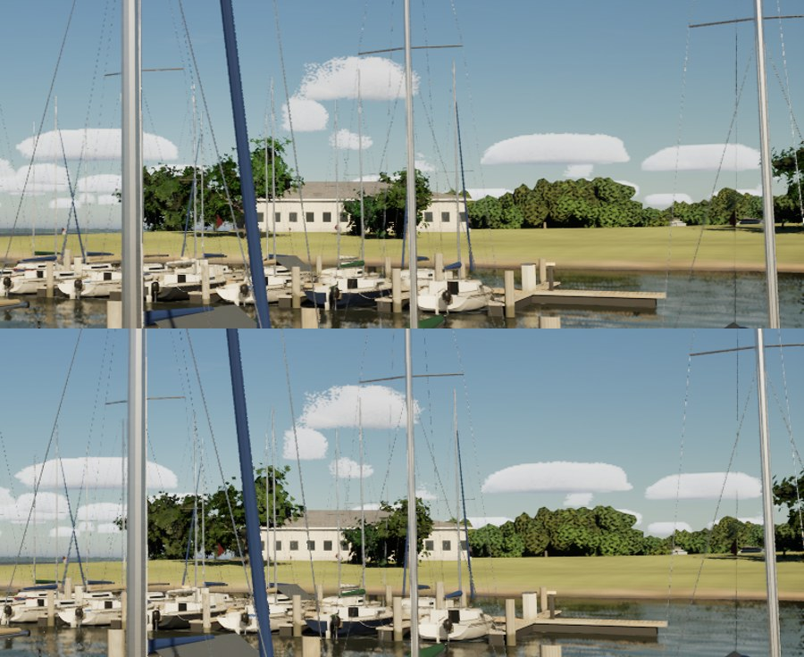

# T2: photographed leaves and scanned bark

The near trees' leaf cards and trunks now wear photographs instead of drawn shapes, all CC0 from ambientCG
(`Inputs/trees/ambientcg`: LeafSet016, 019, 022, 024 colour, opacity and OpenGL normal; Bark001 colour, normal and
roughness; rows in `docs/licences/assets.csv`).

- **The atlas:** `Tools/blender/make_leaf_atlas.py` composes each species' spray (live oak, post oak, cedar elm, red cedar)
  from the photographed leaves along drawn twigs, exposure-matched to the drawn atlas so the lake's tone holds (x0.49),
  and writes the matching normal atlas `T_LeafAtlasN`.
- **Materials:** `build_trees_materials` (make_materials.py) reads both (`scan_texture`, the GL normals' green flipped),
  and the bark samples the Bark001 scan (`/Game/World/Trees/Scanned`).
- **Cost:** two more texture samples in `M_TreeLeaves` (the normal atlas) and three in `M_TreeBark`; no geometry change.

Run: `python Tools/blender/make_leaf_atlas.py Artifacts/models/world/T_LeafAtlas.png`, then
`scripts\windows\run-python.ps1 -Script make_materials.py -Only build_trees_materials`.

