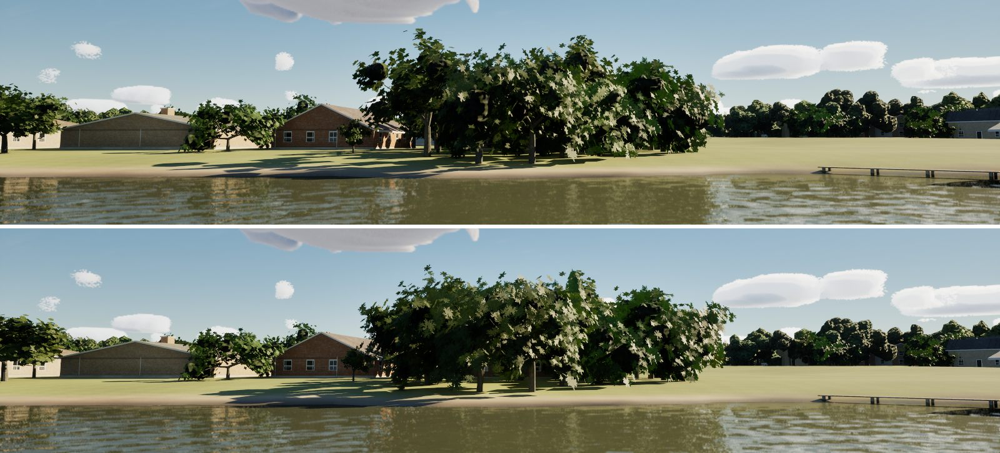

# T2: photographed leaves and scanned bark

The near trees' leaf cards and trunks now wear photographs instead of drawn shapes, all CC0 from ambientCG
(`Inputs/trees/ambientcg`: LeafSet016, 019, 022, 024 colour, opacity and OpenGL normal; Bark001 colour, normal and
roughness; rows in `docs/licences/assets.csv`).

- **The atlas:** `Tools/blender/make_leaf_atlas.py` composes each species' spray (live oak, post oak, cedar elm, red cedar)
  from the photographed leaves along drawn twigs, exposure-matched to the drawn atlas so the lake's tone holds (x0.49),
  and writes the matching normal atlas `T_LeafAtlasN`.
- **Materials:** `build_trees_materials` (make_materials.py) reads both (`scan_texture`, the GL normals' green flipped),
  and the bark samples the Bark001 scan (`/Game/World/Trees/Scanned`).
- **Cost:** two more texture samples in `M_TreeLeaves` (the normal atlas) and three in `M_TreeBark`; no geometry change.

Run: `python Tools/blender/make_leaf_atlas.py Artifacts/models/world/T_LeafAtlas.png`, then
`scripts\windows\run-python.ps1 -Script make_materials.py -Only build_trees_materials`.

## Species (T2's second step)

The plan's trees for each shore, from the same four photographed leaf sets (no new downloads):

| World | Species |
|---|---|
| Lake Ray Hubbard (cross timbers) | post oak, cedar elm, **sugarberry**, a few live oaks, eastern red cedar on the banks; **black willow** and **cottonwood** on the low ground by the water (canopy-map trees under 2.5 m above the pool, lidar crowns under 1.8 m) |
| Galveston Bay, the Gulf passage, the Texas coast | live oak most, **sugarberry** (hackberry), a few cedar elms, **salt cedar** on the low ground by the water (under 2 m above MLLW) |
| Marseille | V6's four, unchanged (its own trees are still to do) |

- **Atlas:** 4x2 tiles (4096 x 2048). The first four sprays are T2's, unchanged (same seed, same x0.49 exposure); the new
  row is sugarberry (LeafSet024 narrowed), black willow (LeafSet022 cut to a third of its width: long, narrow leaves),
  cottonwood (LeafSet024 widened, brighter) and salt cedar (LeafSet019 in fine grey-green sprays).
- **Models:** `build_trees.py`'s new `stemmed` kind grows one or more trunks from the ground, splayed and leaning to +X:
  black willow two or three leaning trunks with an open crown, cottonwood one tall trunk, salt cedar a clump of six to
  nine stems. The placement turns a willow's, cottonwood's or salt cedar's lean downhill, toward the water
  (`TreeRegionFor`, `PlaceTreeInstances` / `PlaceCrownTrees`). Autumn: the new species turn yellow (willow and cottonwood
  brightest); live oak and red cedar stay green.
- **Compare:** `-SailingClassicSpecies` places V6's four species everywhere. Test: `SailingSim.Visual.TreeSpecies`.
- Rebuild: `python Tools/blender/make_leaf_atlas.py Artifacts/models/world/T_LeafAtlas.png`, Blender
  `build_trees.py -- Artifacts/models/world`, `run-python.ps1 -Script make_materials.py -Only build_trees_materials`,
  then `ONLY=SM_LiveOak,...` `run-python.ps1 -Script import_world.py`.

Cost on Ultra (PC, eight views, before at main de1046ee and after): GPU +0.0 to +0.25 ms a frame (base pass up to
+0.15 ms), inside the plan's 1 ms; frame rates within the CPU-bound noise (the new models are 11k to 14k triangles, like
the oaks; salt cedar 8.5k).
