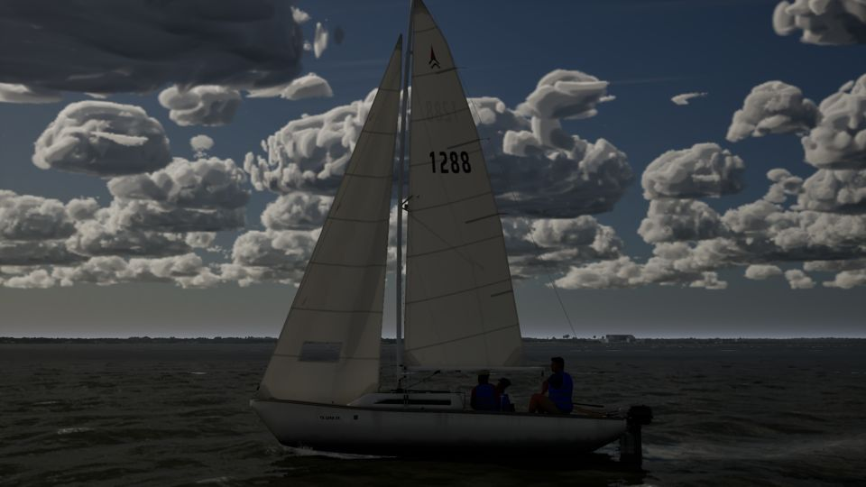
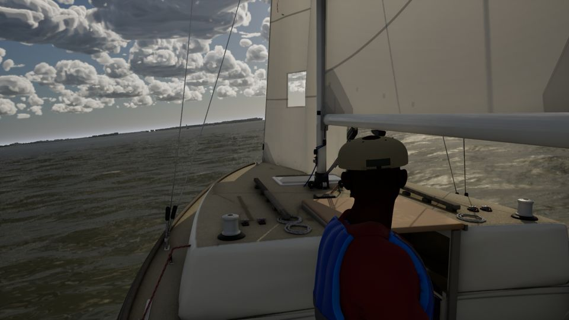
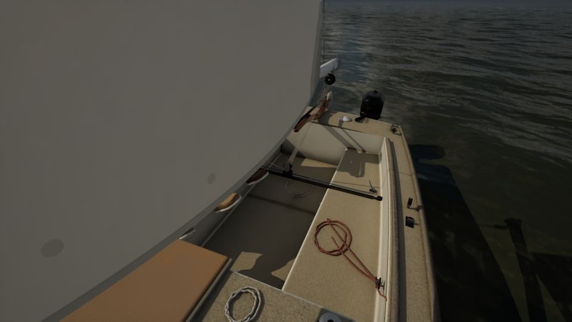
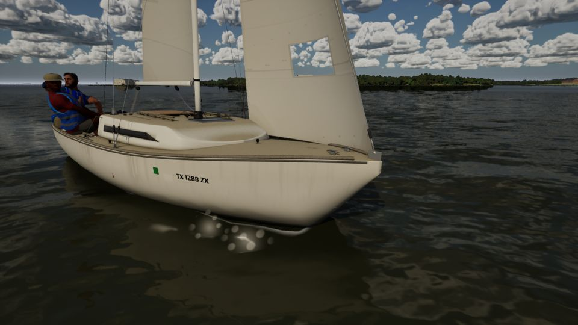
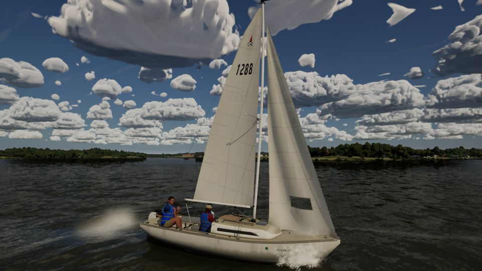
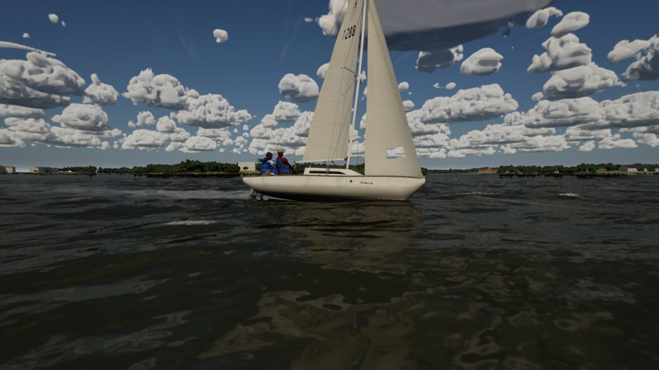
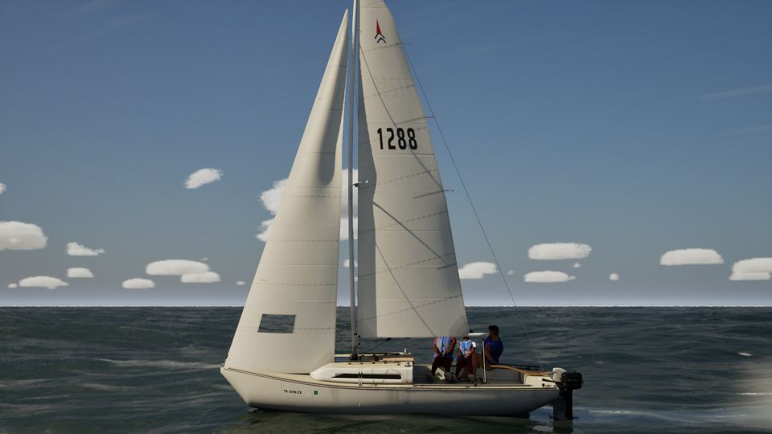

# Ultra against the AAA north star (audit, 2026-10-24)

This is a report only, with no code. Ultra stills on main c9b7e9f1 (the PC, RTX 4090, 1920x1080, uncooked) are judged
against the north-star set Bean confirmed on Oct 20:

- MSFS 2024, AC Shadows, Ghost of Yotei, KCD2, Indiana Jones, Clair Obscur, Black Myth: Wukong and the Witcher 4 UE5
  demo;
- the latest Far Cry and Battlefield for close-up boats, cockpit and helm views, and crew.

Public screenshots of those games were a mental reference only; none was downloaded or committed. The stills here are the
game's own:

- the J/22 hero chase, helm-eye and action-cam captures at 14 kn;
- close views of the cockpit and bow at 8 kn;
- the sails at 12 kn;
- a low view of the water at 16 kn;
- the Gulf with a 1.5 m swell.

## The gaps, biggest first

| # | Gap | What it looks like here, against the references | Lane |
| --- | --- | --- | --- |
| 1 | **Cumulus read as cotton puffs.** | Every outdoor shot has a sky of similar lumpy blobs, each soft all round and much the same size, packed evenly to the horizon. MSFS 2024's cumulus (and AC Shadows', KCD2's) have flat, darker bases on a common condensation level; crisp, sunlit cauliflower tops; wispy, ragged edges; size classes from towers to scraps; and gaps of clear sky that let the field read as weather. Ours is the first thing the eye lands on in a wide shot. | Mac (sky) |
| 2 | **Backlit and shaded faces go near-black.** | In the chase, helm-eye and action-cam captures, the sails, crew and water fall to silhouette against a bright sky: the crew's faces and vests carry no fill, and the cockpit is in shadow it would never be on a lake. The references keep detail in shadow (sky fill, ground and water bounce, and a filmic shoulder on the highlights rather than a crush in the lows). Part exposure and tonemapping, part how much skylight and GI the boat and crew get on Ultra. | Mac (exposure); PC (Ultra GI, the boat and crew materials' fill) |
| 3 | **The water near the boat smears.** | In the low view the near water is soft and smudgy, with blurred reflections and no small-scale glints or capillary detail. The bow wave and spray read as soft white sprites (the close-bow and sails stills), not sheets and droplets. The references' oceans (AC Shadows' coast, MSFS's sea) hold crisp detail up to the hull and break the bow wave into spray with motion. | Mac (water, spray) |
| 4 | **Gelcoat looks matte.** | The J/22's hull and deck read as flat cream plastic. There is little clear-coat reflection of the sky and shore along the topsides, no crisp highlight running down the sheer, and little grime or ambient occlusion in the corners of the cockpit, coaming and hardware. Far Cry's and Battlefield's boats get much of their reality from a strong clear-coat reflection, contact shadows and wear that collects where hands and feet go. | PC (boats) |
| 5 | **Sails are smooth sheets close up.** | At 8 to 12 m the main and jib are smooth, evenly lit surfaces with painted seams. They have none of the fine wrinkles a real sail has at the luff tape, clew and batten pockets, little cloth weave in the specular, and the window is a flat grey panel. In the Gulf still, backlit, they are better. | PC (sail look); Mac (FSailCloth, for geometric wrinkles) |
| 6 | **Lines alias and lose their rope.** | Shrouds, halyards and sheets break into stair-stepped, flickering threads in the wider shots, and close up they are plain cylinders. In the references, lines hold a steady width with distance and show lay and wear up close. | PC (boats: rig lines) |
| 7 | **Crew are stiff, and their clothes are rigid.** | The MetaHumans' faces hold up when lit, but the vests and shirts don't move with the body or the wind, and the poses read as held. Battlefield's and Ghost of Yotei's characters sell themselves with cloth simulation and secondary motion. | Mac (crew) |
| 8 | **Far shores are flat bands.** | The shore at 1 to 3 km is a dark strip of blobby tree crowns under a uniform haze, with little height variation, no atmospheric layering between ridges, and buildings that are boxes. MSFS's photogrammetry is out of reach, but its haze layering and KCD2's distant tree silhouettes show what reads as depth. | PC (world LOD on Ultra); Mac (haze) |

## What already holds up

- **Sails in backlight:** the Gulf still's translucency and seams are close to the references.
- **The hero's hardware close up:** the boat-fidelity passes' winches, cams, tiller and outboard.
- **Light on the water at a distance.**
- **The near shore's plants:** since #266, #285 and the weed pass.

## Stills (Ultra, main c9b7e9f1)

