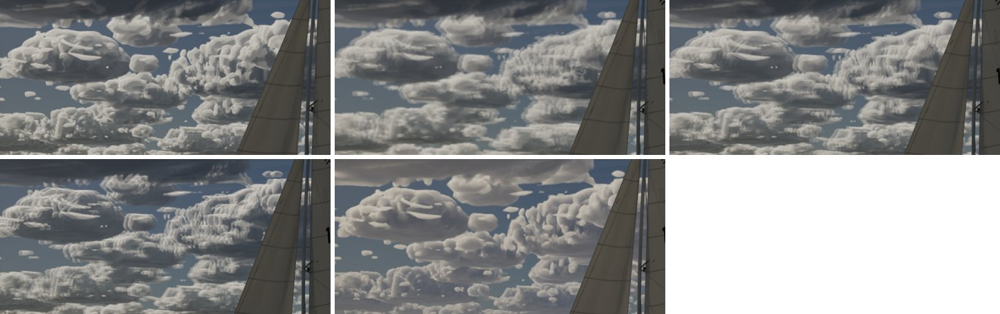
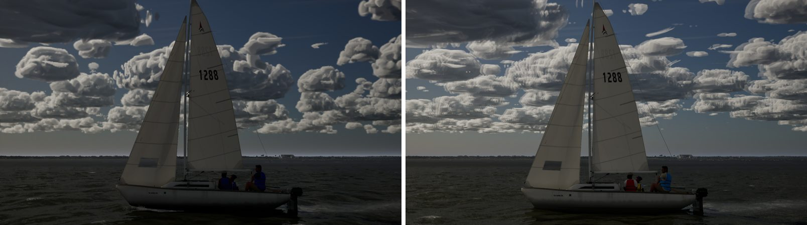
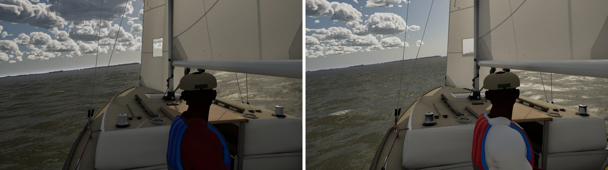
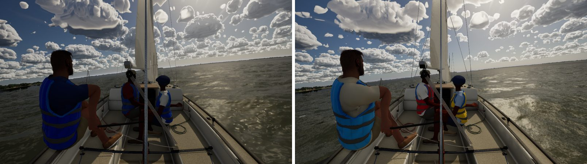
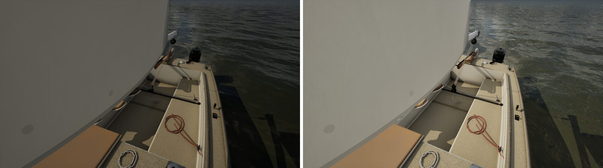
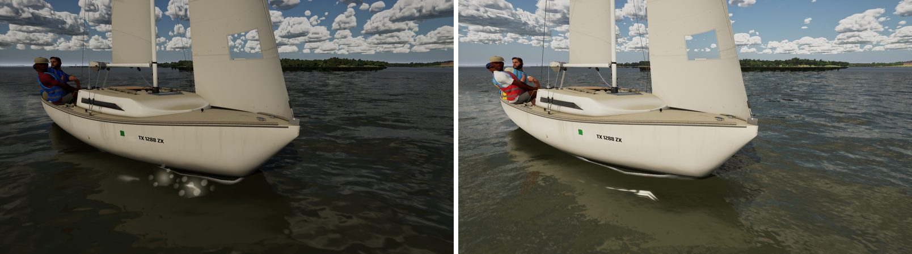
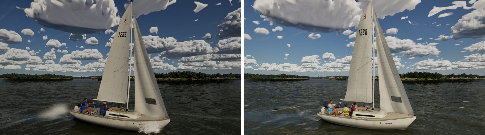
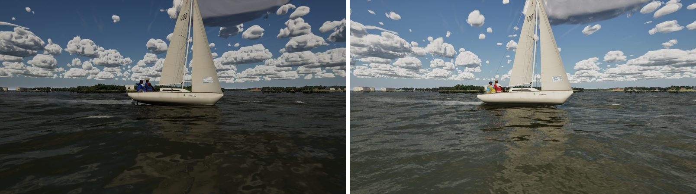
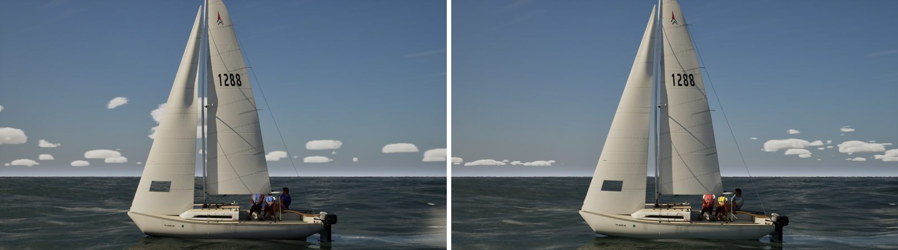
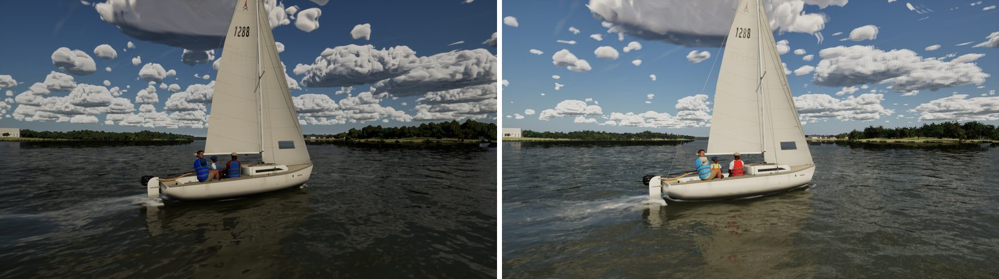

# Ultra against the AAA north star: follow-up (2026-10-25)

A re-shoot of `docs/ultra-audit-1024/`. This is a report only, with no code. Same nine views and arguments, Ultra on the PC
(RTX 4090, 1920x1080, uncooked) on main ad0a1d72, against the audit's stills on c9b7e9f1. Each sheet is the audit on the
left and today on the right. The same north-star set applies: MSFS 2024, AC Shadows, Ghost of Yotei, KCD2, Indiana Jones,
Clair Obscur, Black Myth: Wukong, the Witcher 4 UE5 demo, and Far Cry and Battlefield for the boats and crew. As before,
those were a mental reference only.

In this round (merged between c9b7e9f1 and ad0a1d72):

- Boats and rig: #308 to #312, #315.
- Sky: #313 (cumulus shape), #316, #317 and #321 (Ultra cloud tops, sky cache, the full-res experiment), #324, #325
  (mast specks, near-cloud grain).
- Light: #314 (exposure fill), #320, #330 and #333 (water bounce, its readback, its sun term).
- Crew: #318, #319 and #327 (crew colours, skin backlight and its side-light patch), #332 (shirt flutter).
- Sails: #322 (cloth shading), #331 (edge speckle).
- World and water: #323 (far shore), #326 (near water and spray), #329 (Ultra spray).

## The eight gaps

| # | Gap | Now | Status |
| --- | --- | --- | --- |
| 1 | Cumulus read as cotton puffs | Flatter bases on a common level, more size classes and more clear sky between them (actioncam, sails, water-low). But the mid-distance cumulus in the chase are now streaked and bladed: see "New" below. | **Partly closed; new artifact** |
| 2 | Backlit and shaded faces go near-black | The cockpit close-up and helm eye are visibly lifted: the water bounce (#320) fills the cockpit floor, sails and crew. The crew read by colour now (#318) and their skin glows at the rim in profile (#319; the side patch halved by #327). The chase into the light is still dim overall: exposure, the Mac's. | **Mostly closed** (exposure left) |
| 3 | The water near the boat smears | The capillary cascade (#326) gives the near water glints and wavelets (water-low, close-bow). The "ping-pong ball" spray at the bow (close-bow, sails) is gone: the bow wave is a sheet and the spray is droplets and strands. #329 adds Ultra's wisps and a streaked bow-wave lip. | **Closed** at these distances |
| 4 | Gelcoat looks matte | At this size the topsides read glossier, with sky in them (close-bow, gulf), and the cockpit corners carry grime (close-cockpit). The close-up proof is in `docs/gelcoat`. | **Closed** at these distances |
| 5 | Sails are smooth sheets close up | At 8 to 12 m (sails) the sails are much as before. The close-up crinkle, weave and wrinkle shading (#322) is for arm's length and shows in `docs/sail-cloth-shading`, not at these distances. The window still reads as a flat grey panel. | **Closed close up**; window left |
| 6 | Lines alias and lose their rope | In these stills the shrouds and halyards read as continuous lines (chase, sails). The flicker measure and the rope lay are in `docs/rig-lines`. | **Closed** (stills; motion measured there) |
| 7 | Crew stiff, clothes rigid | Unchanged on the PC: #332's shirt flutter waits for the new crew zip (the old white polos stay still by design until then). | **Open** (zip pending) |
| 8 | Far shores are flat bands | Within a kilometre the shore has leaf-card trees with ragged outlines on Ultra (#323; sails, dusk). Further out, and the haze layering between ridges, unchanged. Buildings are still boxes. | **Partly closed** (haze and houses left) |

## New

- **Streaked, bladed mid-distance cumulus (chase).** The cumulus 3 to 10 km out show smeared, blade-like ridges and
  blocky stretched lobes. The audit's cumulus were soft puffs here. It isn't one of Ultra's cloud settings: turning each
  off in turn leaves it there (the sky cache at its old 4096x512, the second billow octave, the near-step cap floor, and
  the sky cache off altogether). So it is in the cloud shape on main, the Mac's sky lane (#313's cumulus shape is the likeliest suspect: not bisected). Left to right, top to bottom:
  main, cache 4096x512, billow octave 0, cap floor 0, no sky cache.

  

- **The "dusk" view is still daylight** at `-SailingHour=19.6`, in the audit too. The view is mislabelled, or the date
  puts sunset later. It isn't a regression.
- **The 2 s game-thread hitch** (the weather map's hand-off) is in this build. The Mac is fixing it.

## Sheets (audit on the left, today on the right)

| View | Sheet |
| --- | --- |
| Chase, 14 kn |  |
| Helm eye |  |
| Action cam |  |
| Cockpit close-up, 8 kn |  |
| Bow close-up, 8 kn |  |
| Sails, 12 kn |  |
| Water, low, 16 kn |  |
| Gulf, 1.5 m swell |  |
| "Dusk" (19.6 h) |  |

The water, clouds and crew poses move between runs, so the frames are matched in view, not in detail.

## Biggest gaps now, in order

1. The mid-distance cumulus artifact (new), then the cumulus field's remaining "cotton" read (Mac, sky).
2. Exposure into the light: the chase into the sun still sits dark (Mac, exposure).
3. Crew cloth motion (Mac, crew), once the zip is on the PC.
4. Far shore haze layering and the houses' boxes (Mac, haze; world kit).
5. The sail window's flat grey panel (PC, sails).
