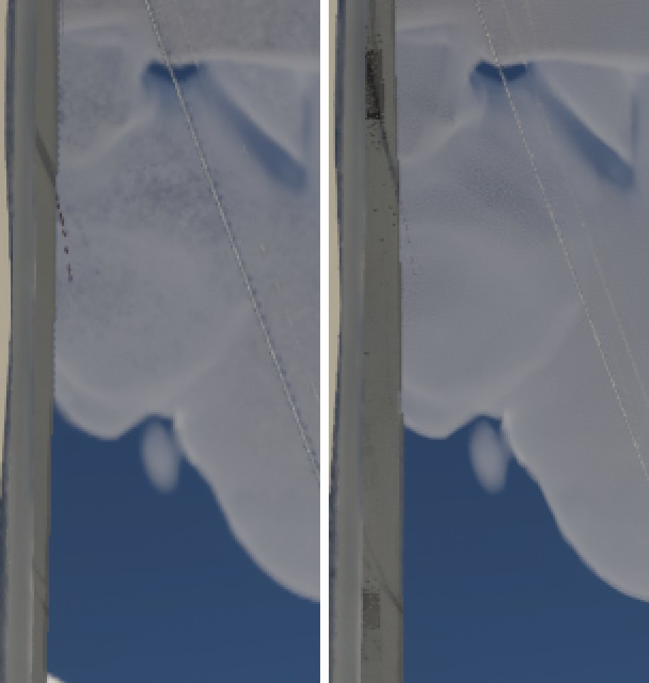
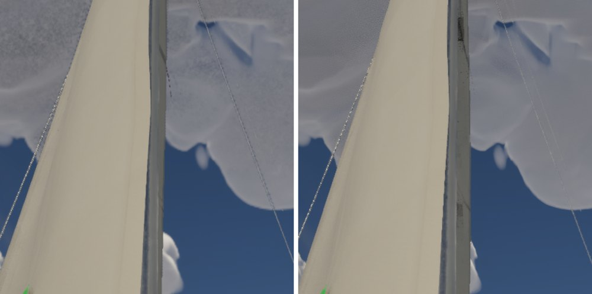
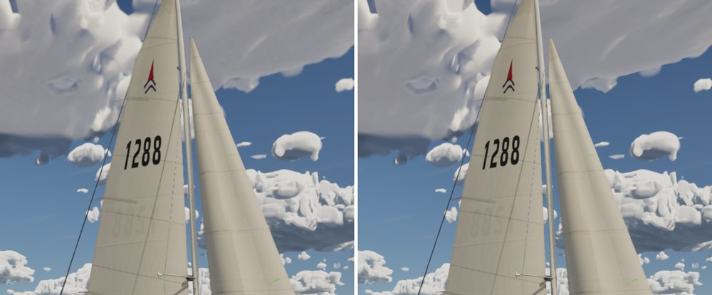
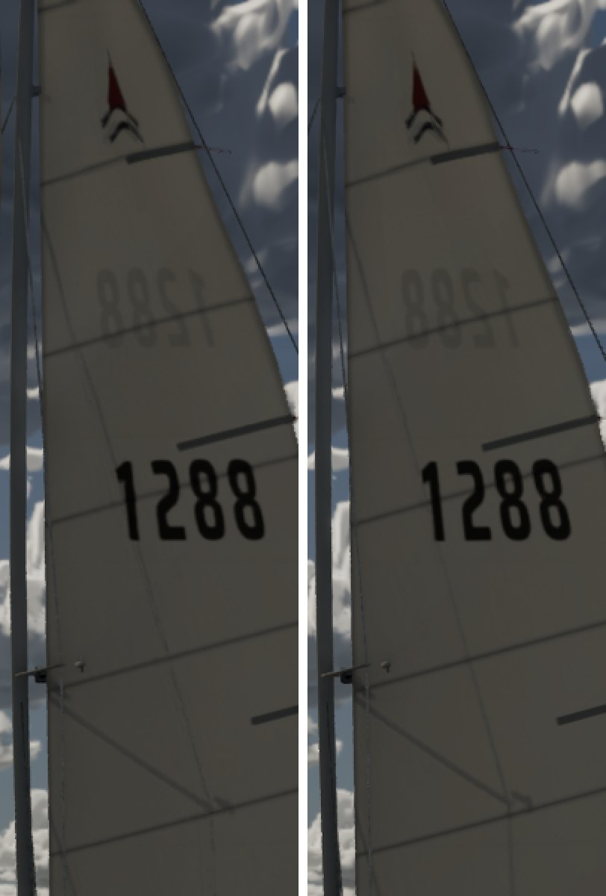

# Ultra clouds traced at full resolution: an experiment

Option (a) from `docs/ultra-cloud-tops/`, as a measured experiment only: `r.VolumetricRenderTarget.Mode` 3 (the engine's
cinematic mode, clouds traced at full resolution) against Ultra's mode 1 (half resolution plus upsampling). Per the sim
thread it doesn't merge without stills of the clouds compositing over the mast and sails. No code here; it was run with
`-SailingExecAt=1:r.VolumetricRenderTarget.Mode+3` on main 81771c73.

## Cost (Ultra, 1920x1080, Bean's RTX 4090, mean of three 20 s runs)

| View | Clouds ms, half | Clouds ms, full | GPU ms, half | GPU ms, full |
| --- | --- | --- | --- | --- |
| The audit's sails view (rig and sails against cumulus) | 1.71 | 2.02 | 7.67 | 8.12 |
| The masthead from the cockpit, 35 deg up (a cloud overhead) | 1.75 | 2.87 | 6.47 | 7.63 |
| Chase | 0.86 | 0.87 | 6.64 | 6.68 |

## Compositing (half resolution on the left, full on the right)

| The mast against the cloud overhead, 3x | The masthead view |
| --- | --- |
|  |  |

| Sails view | Chase |
| --- | --- |
|  |  |

- **Better:** the near cloud overhead loses most of its speckle (the march's grain at half resolution), and its edges
  are crisper.
- **Worse: the mast.** At full resolution, dark speckled blocks appear on the mast where it crosses the cloud: the
  cinematic mode's composite over thin opaque geometry. At half resolution there are only a few dark-red specks along
  the mast's edge, an existing artifact of the upsampler's depth test.
- The sails and the chase show no difference worth the cost: the sails' edges composite cleanly either way, and in the
  chase the clouds are small in frame.

## Verdict

Not recommended as it stands. It costs up to 1.2 ms where the clouds fill the frame, buys a cleaner near cloud, and
breaks the mast's composite. If the near clouds' grain is worth chasing on Ultra, cheaper levers come first:
`docs/ultra-cloud-tops/`'s footprint and billow settings (merged) and the march's step-depth cap on near rays. The mast
artifact would also have to be solved first (a depth-aware composite, or keeping mode 1's upsampling with a finer
reconstruction).
