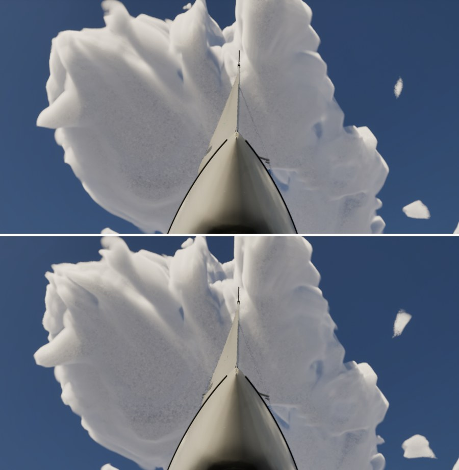
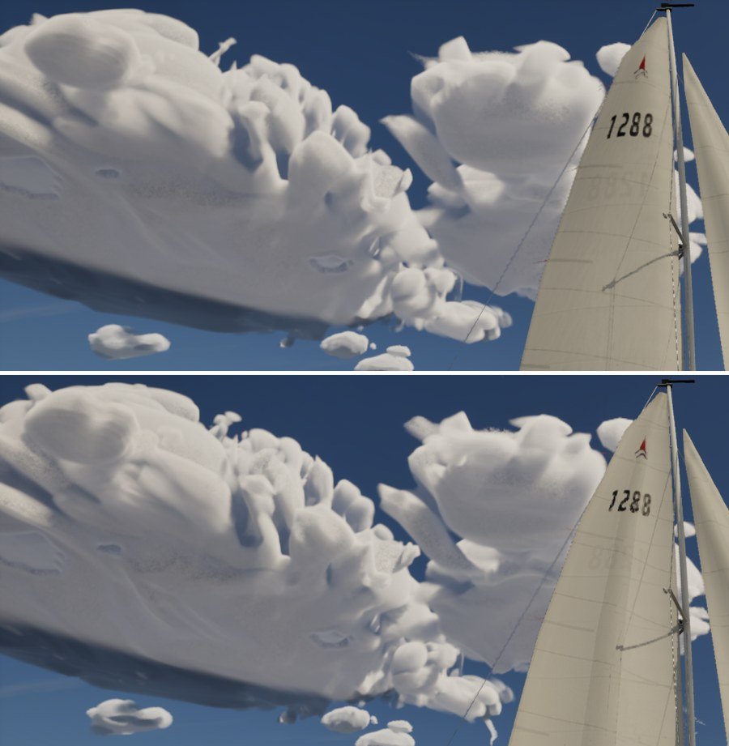
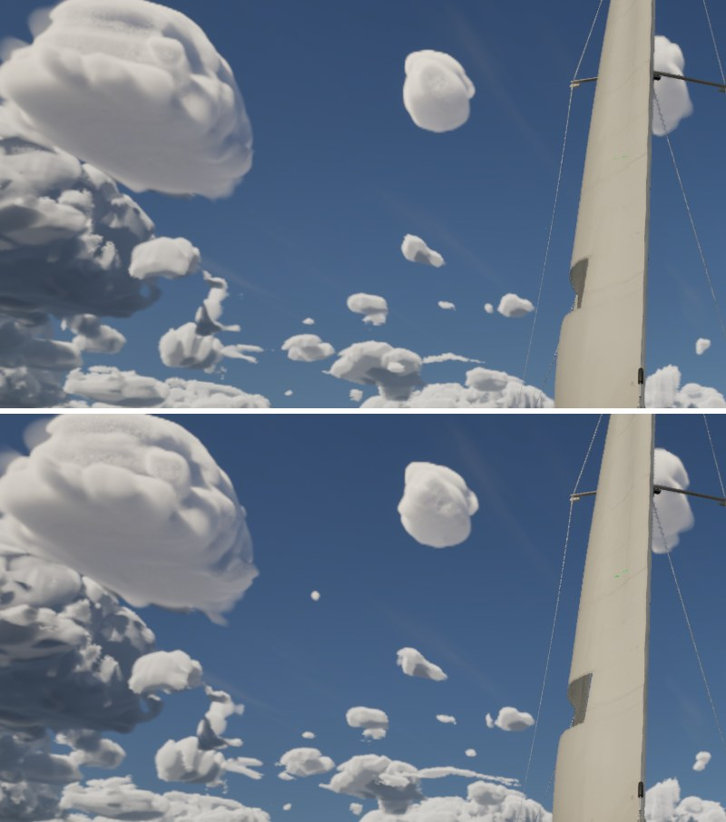

# Ultra cloud tops

Ultra audit item 1 follow-up (#313, the cumulus field): crisper sunlit tops and cauliflower detail on small cumulus,
on Ultra only. Medium and High must stay as they are.

## What changed (Ultra only)

- **Three new cloud material scalars**, read by `CLOUD_CODE` in both `M_CloudLayers` and `M_CloudCache`
  (`cloud_tops()` in `make_materials.py`). Their defaults are the old constants, so every tier but Ultra computes
  exactly what it did:
  - `CloudFootFloor` (110 m): the noise footprint floor, `foot = max(distance * 0.0022, max(FootFloor, 0.85 * step))`.
    The step term still binds wherever the march is coarser, so the no-alias rule (nothing finer than the march step)
    holds.
  - `CloudEdgeTop` (4): the cumulus edge-to-body ramp at the top of a cell (`lerp(2.5, EdgeTop, height)`).
  - `CloudBillow2` (0): a second billow octave, the same `T_CloudBillow` field at three times the frequency (100-270 m
    lobes, a 1 km tile) on the cell's upper part, filtered by the same footprint. At 0 the branch is skipped.
- **Ultra sets** floor 60 m, ramp 5 and the second octave at 1.5 (`kUltraCloud*` in `SailingEnvironment.cpp`) on the
  live clouds, and the sky cache copies them with its other parameters. Measuring: `-SailingCloudFoot=<m>`,
  `-SailingCloudEdge=<ramp>`, `-SailingCloudBillow2=<weight>`; any tier takes them.

## What limits small cumulus on the PC (the sweep)

A view at 22 deg up with the sun behind (yaws 180 and 270 off the J/22's bow, AfternoonBreeze at 15:00) and one at 45 deg.
The cloud slice is `gpu.clouds_fog_ms` (Ultra, 1920x1080, one run each, 4090). Stills in `Artifacts/cloudtops`.

| Setting | Clouds ms, yaw 180 / 270 | What it did |
| --- | --- | --- |
| Main (floor 110, ramp 4) | 1.43 / 1.69 | Small cumulus are smooth single lobes |
| Floor 70 / 50 / 35 | 1.48-1.50 / 1.73-1.86 | Barely visible: a touch more texture on near clouds |
| Ramp 5.5 | as floor 50 | Slightly crisper outlines |
| Samples x3 (`-SailingCloudScale=3,4`) | 1.47 / 1.77 | Nothing: `r.VolumetricCloud.ViewRaySampleMaxCount` (160) caps the count |
| x3 with the cap at 320 | 1.97 / 2.36 | Barely visible |
| x4, cap 400, floor 45, ramp 5 | 2.29 / 3.36 | Slightly lumpier outlines |
| Second billow octave 1 / 1.5 / 3 / 5 | 1.50-1.79 / 1.87-2.13 | Small bumps on near tops; little change on the far field |
| Full-resolution tracing (`r.VolumetricRenderTarget.Mode` 3) | 2.18 / 2.53 | No change on the far field |
| No sky cache, 45 deg, main | 2.52 / 2.14 | |
| No sky cache, octave 3, floor 45, ramp 5.5, full resolution | 4.33 / 4.04 | Clearly more defined lobes and less speckle on the near clouds overhead |

What this says on the PC:

- **Most small cumulus in a sailing view are sky cache.** Past 5 km (`kSkyCacheSplitM`) the clouds are a 4096x512
  panorama (0.088 deg a texel, about twice the screen's 0.047 deg at 90 deg FOV) marched in 96 steps out to 40 km (steps
  of hundreds of metres). There the step binds the footprint, and neither the floor nor the samples nor the trace
  resolution reach them. That's why the far field is the same in every row.
- **On the live clouds (under 5 km)** the floor and samples matter only together with the trace resolution: Ultra traces
  at half resolution (0.094 deg a pixel). Full resolution plus the finer noise gives the clearest gain, but doubles the
  cloud slice.
- So, unlike the Mac's read, the footprint floor alone isn't what holds the 4090 back. The resolution of what draws the
  clouds is: the half-resolution trace near, the cache's texels and steps far.

The shipped setting takes the cheap part: floor 60, ramp 5, octave 1.5, at about +0.1 ms. The rest is listed as options
below, with their measured cost.

## Before and after (Ultra)

Cloud slice, mean of three 20 s runs (Ultra, 1920x1080). "Before" is this build with main's values by argument
(`-SailingCloudFoot=110 -SailingCloudEdge=4 -SailingCloudBillow2=0`), numerically main's material:

| View | Before ms | After ms |
| --- | --- | --- |
| 22 deg up, yaw 180 | 1.52 (1.62 1.46 1.48) | 1.53 (1.52 1.59 1.48) |
| 22 deg up, yaw 270 | 1.77 | 1.79 |
| 45 deg up, yaw 180 | 1.82 | 1.76 |

Sheets (before above, after below):

| 45 deg up, the cloud overhead | 22 deg, yaw 270 | 22 deg, yaw 180, the small ones |
| --- | --- | --- |
|  |  |  |

Modest: the near clouds' outlines and tops are lumpier and slightly crisper (the right-hand cloud at yaw 270, the edges
overhead). The far field, where the sky cache draws, is unchanged. The fine grain on the near cloud bodies was there
before and is no worse.

## Options not taken (measured, Ultra on the 4090)

- Full-resolution tracing (`r.VolumetricRenderTarget.Mode` 3): +0.6 ms with the cache, +1.8 ms without; sharper near
  clouds. It also changes how clouds composite over opaque meshes (the engine's cinematic mode).
- `ViewRaySampleMaxCount` 320 with view scale 3: +0.5 to 0.7 ms; little visible on its own.
- A finer sky cache on Ultra (8192x1024, or 192 steps): the only lever on the far small cumulus. It costs four times the
  cache's strip per frame plus 128 MB of targets. Not tried here; it changes `kSkyCache*`, which High shares.

## Medium and High

They never set the three scalars, and the material's defaults are the old constants, so `CLOUD_CODE` computes the
same values there (110.0, 4.0, and the octave's branch skipped). The Mac gates byte-for-byte neutrality.

## Checks

Full suite 235/235 on the PC on main 75a76a16 plus this branch (MSVC clean).
