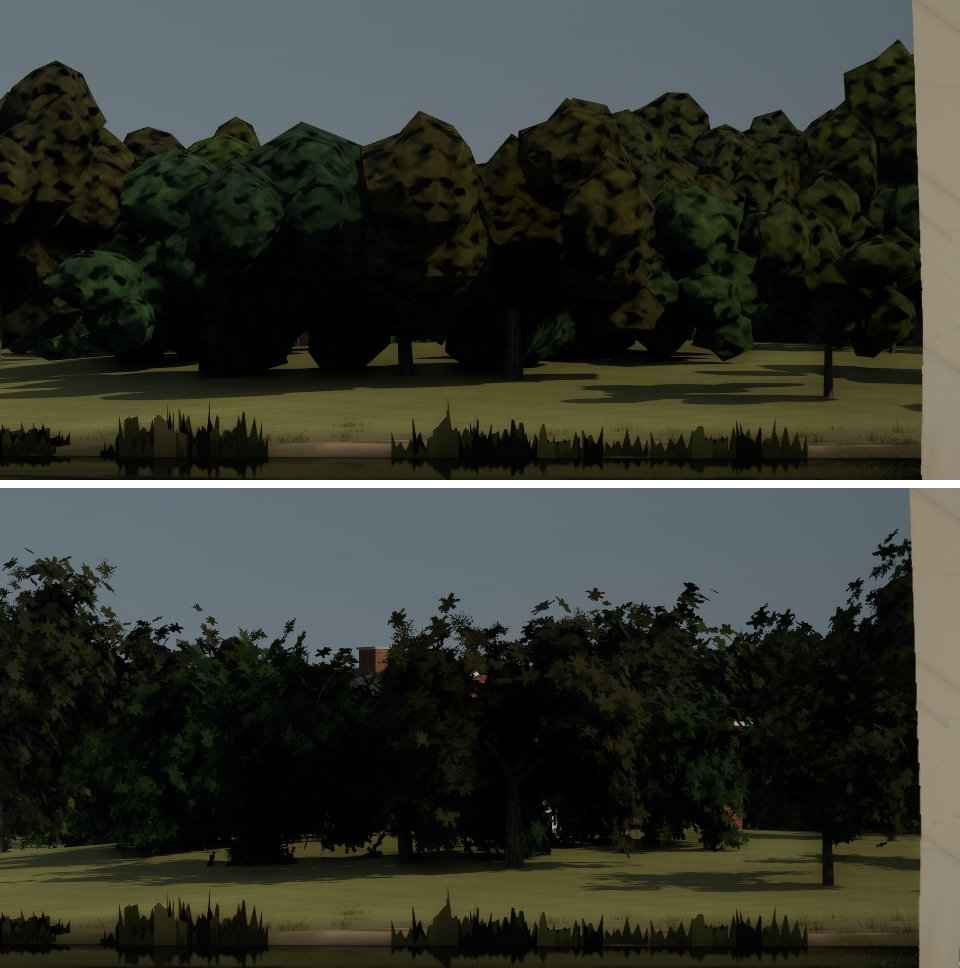
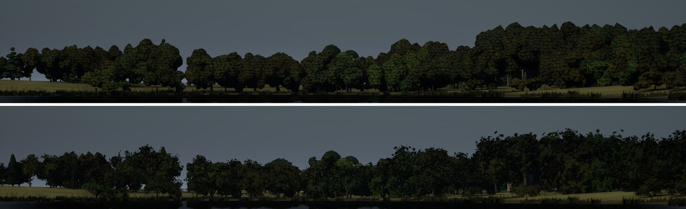
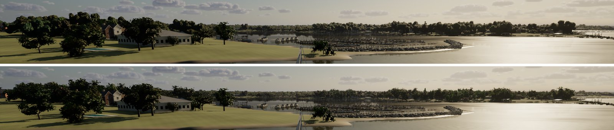

# Ultra far shore (Ultra audit #8, the PC's half)

The Ultra audit (`docs/ultra-audit-1024/`) found the shore at 1 to 3 km reading as a flat band of blobby crowns. The haze
layering between ridges is the Mac's (haze). This is the PC's half: the world's level of detail on Ultra.

## What it was

Graphics G6 draws a tree's leaf-card model only within 250 m on High and Ultra. Past that it draws the far model
(`SM_<Species>_<n>_Far`), a dozen lumpy icosphere blobs under the opaque `M_TreeCrown`. On Ultra's 1920 px those blobs
show their facets and smooth outlines from about 300 m on. Through a long lens they are faceted polyhedra with a
camouflage dapple (top halves of the sheets below). The 250 m edge was set for the Mac's High (leaf cards to 600 m cost
it 8 ms of base pass at the marina).

## What changed

- **Ultra draws the leaf cards to 1 km** (`NearTreesM()` in `LakeTerrainActor.cpp`; High 250 m and Medium 200 m are
  unchanged). The shore within a kilometre now has each tree's own ragged outline, its light through the leaves and
  sky between the branches. The opaque crowns take over past 1 km. Ultra's shadowed mid band (to 1 km) is empty now:
  the leaf cards cast their own shadows. Past 1 km nothing changes.
- I tried, and left out, shadows on the crowns past 1 km on Ultra (`-SailingMidTrees=2500`). They cost nothing
  measurable but don't show at 1 to 3 km.

## Look (Ultra, 1920x1080; main on top, this branch below)

| View | Sheet |
| --- | --- |
| East from the start, 15 deg lens (trees at 300 to 600 m) |  |
| North from the start, 15 deg lens (600 m to 1 km) |  |
| The marina view, normal lens (the far side of the cove) |  |

Past about 2 km (the lake's far shores from the start) the frames are unchanged: there the crowns are a few pixels
each and read as the treeline they are.

## Cost (`gpu.total_ms`; base pass), Bean's RTX 4090, Ultra, 1920x1080, one 20 s run each

| View | 250 m (main) | 600 m | 1 km (this branch) |
| --- | --- | --- | --- |
| marina | 7.08 (2.63) | 7.16 (2.70) | 7.27 (2.78) |
| slip | 7.34 (3.07) | 7.41 (3.19) | 7.45 (3.17) |
| helm-eye | 7.90 (3.45) | 7.92 (3.42) | 8.06 (3.75) |
| beam8 | 7.29 (2.88) | 7.11 (2.78) | 7.33 (2.91) |
| stream-run (40 m/s, regrouping) | 8.00 (3.29) | | 7.68 (3.06) |

About +0.1 to 0.15 ms, near the run-to-run noise. Game thread time is unchanged, including stream-run, where the
camera crosses band edges fastest.

**Shimmer.** Leaf cards at 1 km are under a pixel each at a normal lens. I recorded the marina view at 4 Hz for 3 s at
250 m and at 1 km and compared each frame's treeline rows with the mean of its neighbours. The temporal noise was 6.7
grey levels at 1 km against 7.0 at 250 m (the camera's own motion dominates both), so the cards add no
measurable flicker. The Mac's gate doesn't run Ultra, so this is the PC's check only.

## Not in this pass

- **Buildings that are boxes** at 1 to 3 km are the house kit's modelling (`HouseKit.cpp`, baked Nanite), not a level
  of detail. That's a world-kit item of its own.
- **The bank reeds** read as flat jagged cards through a long lens (the tele-east sheet). That's the near-shore plants,
  not the far shore.
- **Haze layering** between ridges: the Mac's.

`-SailingNearTrees=<m>` overrides the band for measuring.
