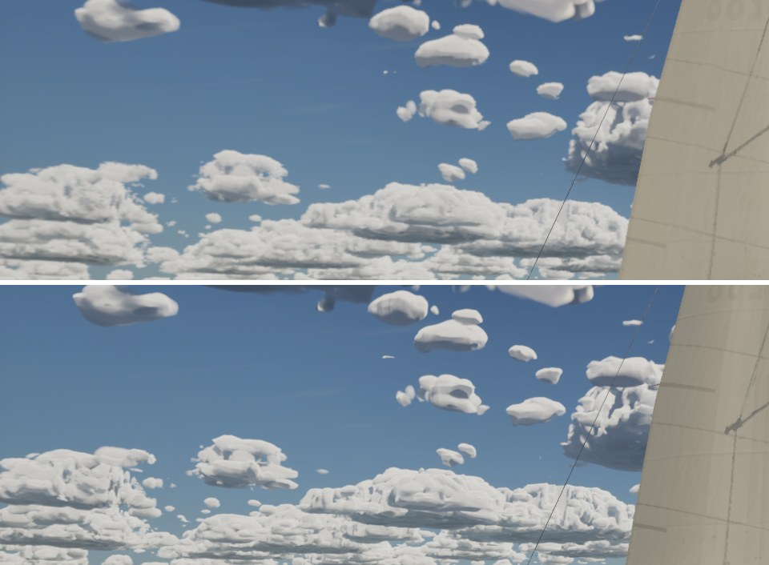
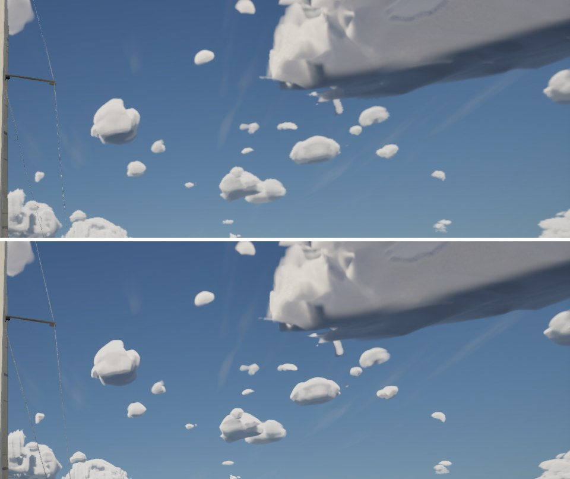

# Ultra sky cache

Follow-up to `docs/ultra-cloud-tops/` (option c, agreed by the sky owner). Past 5 km the clouds are drawn from the
sky cache: a panorama refreshed in strips every four seconds. Its 4096x512 texels (0.088 deg each, about twice the
screen's pixel at 90 deg) and its 96 steps out to 40 km (hundreds of metres a step, which also bind the noise
footprint) are what kept the far small cumulus as soft blobs on Ultra.

## What changed

- `SkyCacheSize()` (`SailingEnvironment.cpp`) gives the panorama's size and march per tier. Ultra:
  8192x1024 and 192 steps (`kSkyCache*Ultra`). Every other tier keeps 4096x512 and 96 steps. The strips follow the
  render target's own size, and `-SailingSkyCacheSize=<w>,<h>,<steps>` overrides it for measuring.
- `M_SkyDome` reads the panorama's size from the texture (`GetDimensions`) instead of a constant `4096 x 512` in its
  B-spline lookup. At 4096x512 that's the same numbers. Medium and High are unchanged: same size, steps, refresh and
  material values. The Mac gates that.

## Before and after (Ultra, 1920x1080, Bean's RTX 4090)

The same build; "before" is `-SailingSkyCacheSize=4096,512,96`.

| View | Before (above) and after (below) |
| --- | --- |
| 8 deg up, toward the horizon (yaw 270): the far field, 5 to 40 km |  |
| 14 deg up (yaw 180): small cumulus a few km out, the big one overhead live |  |

At the horizon the far cumulus have lumpy, cauliflowered tops and crisper outlines where they were soft blobs. That's
the steps: 8192x1024 at the old 96 steps was no sharper (sweep below). Small cumulus nearer than 5 km are live clouds
and don't change (`docs/ultra-cloud-tops/`).

Mean of three 20 s runs:

| View | Setting | GPU ms | Clouds ms | Other ms (the strip draw) | Texture memory |
| --- | --- | --- | --- | --- | --- |
| Horizon | 4096x512, 96 (before) | 7.84 | 1.63 | 1.25 | 3,383 MB |
| | 8192x1024, 96 | 7.73 | 1.61 | 1.27 | 3,479 MB |
| | 8192x1024, 192 (after) | 7.92 | 1.59 | 1.40 | 3,479 MB |
| 14 deg up | before | 7.25 | 1.38 | 1.32 | 3,375 MB |
| | 8192x1024, 96 | 7.27 | 1.38 | 1.29 | 3,471 MB |
| | after | 7.34 | 1.37 | 1.39 | 3,471 MB |

About +0.1 ms a frame and +96 MB (two 8192x1024 RGBA16f targets against two of 4096x512). A whole panorama still
refreshes every 4 s; the first one takes 3.6 s (log: `Sky cache: first panorama in 3.60 s (8192x1024, 192 steps)`).

## Checks

Full suite 235/235 on the PC on main d89da9b4 plus this branch (MSVC clean).
