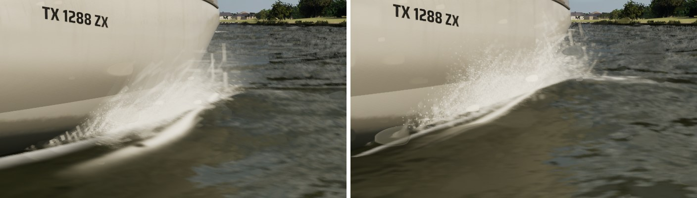
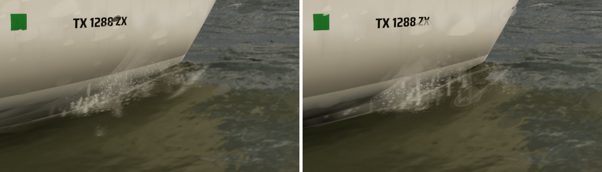

# Ultra spray close up (Ultra audit #3, the PC's half)

The audit found the bow wave and spray reading as soft white sprites close up. #326 (`docs/near-water/`) already redid
`M_Spray`'s pattern for every tier: millimetre drops in the clumps, and sheets as strands along their motion. On
today's main, at 3 m from the J/22's bow at 20 kn, these still read as sprites:

- **The mist** (slam bursts and the drops' leftovers) was a smooth disc with a clean edge: bright soft ovals over the spray.
- **The sheets' strands** ran the quad's whole length: striped flaps, not water tearing.
- **The bow wave's lip** (`M_BowWave`, the curl standing off the bow) was one even white tube along the waterline.

## What changed (Ultra only)

- **`M_Spray`, `Fine`** (a scalar, 0 by default, so Medium and High draw what #326 left). `AWaterSurface::UpdateSpray`
  gives the Ultra spray a dynamic instance with `Fine` 1.
  - Mist is torn into wisps by two octaves of value noise. It thins out and has no rim.
  - Toward their ends a sheet's strands neck and bead into drops, about four strand widths apart (a ligament breaking
    up, Rayleigh-Plateau).
- **`M_BowWave`, vertex colour blue** (`ASailboatPawn::UpdateBowWave` sets it on Ultra).
  - The lip is cut into streaks a couple of centimetres wide and some tens long, running aft with the water.
  - Drops fleck outboard of the crest, more at speed.
  - The clear film carries the same flow lines in its reflection.
- `-SailingNoUltraSpray` turns both off for comparison.

The spray simulation is unchanged: what flies, how fast, how long and how big is main's, so the WaterSurface.cpp diff is
the instance's few lines in `UpdateSpray`.

## Look (Ultra, 1920x1080; `-SailingNoUltraSpray` on the left, this branch on the right)

| View | Sheet |
| --- | --- |
| The bow at 20 kn, 3 m off |  |
| The bow at 14 kn |  |

The spray is random from run to run, so the frames differ in where the drops are. The round grey discs in some frames are
the lens drops (the High lens-water post process), not the spray.

## Cost

The bow at 20 kn filling the frame, two 20 s runs each: GPU 7.19 ms without, 7.41 with (+0.2 ms, inside the spray's own
run-to-run spread).
