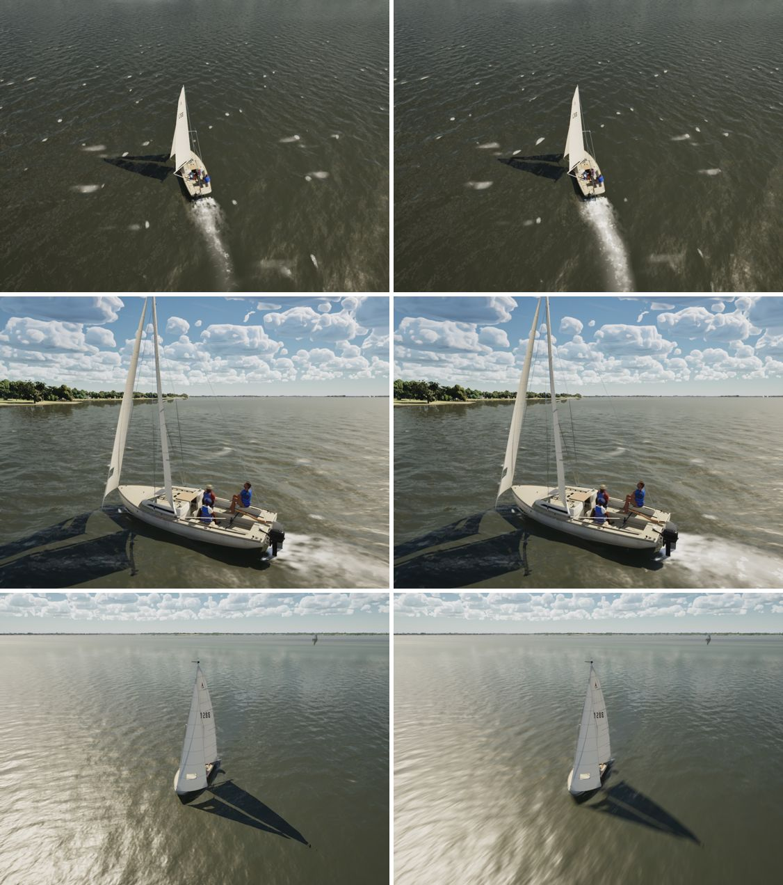

# Wake foam at speed (realism audit item 8)

The realism audit (`docs/realism-audit-1022/`) found the J/22's bow wave and wake weak at speed: at 6–7 kn, a faint
trail. In the photos there is a white bow-wave crest, a quarter wave and a foam lane behind the transom.

## What the wake is

`FWakeGrid` (`WakeGrid.cpp`) solves the waves a hull makes, and its foam builds where the surface moves fast (the bow
wave breaking) and in the turbulence behind the transom. At 15 kn the Kelvin waves of a J/22 (about 10 cm) are lost in
the lake's chop, as they are on real water, so what shows is the white water.

## Change

The foam now starts from 0.25 m/s of surface motion (it was 0.35) and lasts 4 s (it was 2.5). At 6–7 kn, a J/22 near
her hull speed, the bow wave's crest breaks white and the transom's lane runs a few lengths. In light air the surface
moves too slowly to foam, as before.

## Stills

15 kn on a beam reach (the boat about 6.5 kn). Main 5791628d is left, this branch right. From the top:
- from astern and above, 26 m;
- the quarter, 10 m;
- 6 kn, where nothing changes.

## Gate

`--scope water`: pass, 229/229 tests. beam8 61.2, beat15 60.2, storm High 50.8, marina 59.9, coast-day 53.7, gulf-sea
62.3, helm-eye 60.6, bridge 63.8, storm Medium 70.8.
