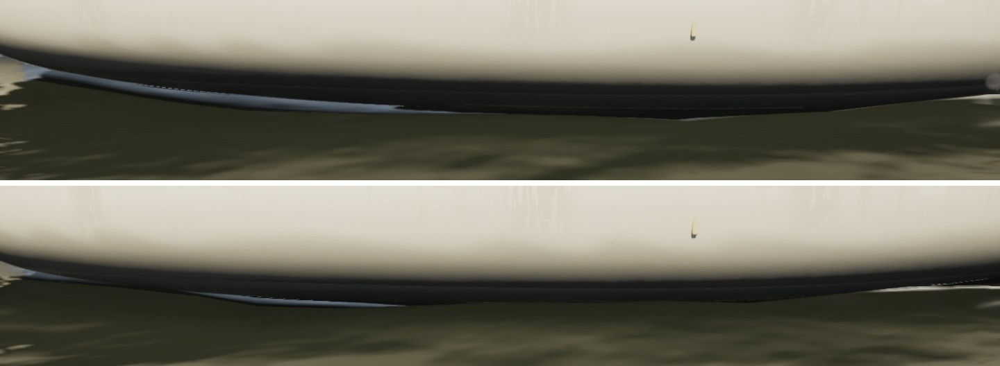
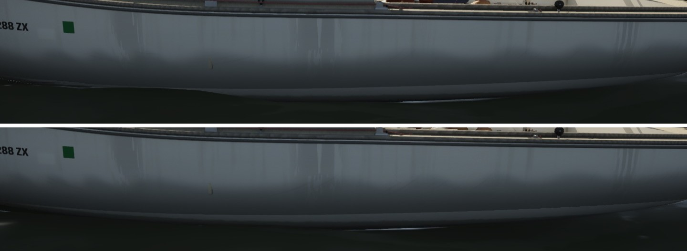

# Water against the hull (realism audit item 9, the water half)

The realism audit (`docs/realism-audit-1022/`) found the boats looked pasted on the water. #262 (the PC) did the hull's
side: its topsides darken toward the water, and the water's tone shows in its low reflection. This is the water's side.

## Change

`M_WaterV4` (`make_materials.py`, `V4_SHADE`) knows each hull's plan from the clip map it already reads for the
waterline foam (`FHullClipMap`), so it knows how far a water pixel is from her side. Water against her side sees her
topsides where it would see sky, and lies in her shade. So, along her length (not ahead of the bow or in the churn
astern):
- its sky reflection is cut by up to half (`HULL_NEAR_SPEC` 0.5);
- its body is darkened (`HULL_NEAR_DARK` 1.2 on `Dark`, as a puff darkens the water);
- both are full under the flare and fade over 35 cm outside it (`HULL_NEAR_M`).

It follows the heel and trim, as the waterline foam does.

The visible effect: the bright strip of sky that showed in the water under the flare, against a hull whose underside is
dark, is gone. The water outside the band is unchanged. No bright reflection of the hull is drawn: on her shaded side
it would be the wrong sign, and in a breeze the chop breaks it up.

## Stills

The J/22's waterline at 10 kn, beat. Main is on top, this branch below, from the lee side and from the shaded side:

## Gate and cost

- **`--scope water`:** pass, 229/229 tests. beam8 59.4, beat15 59.2, storm High 50.5, marina 59.2, coast-day 53.5,
  gulf-sea 62.3, helm-eye 59.1, bridge 62.0, storm Medium 68.4.
- **Against main 514a0e3a,** packaged and benched back to back: beam8 60.3 against 60.6, helm-eye 59.0 against 59.3,
  storm Medium 68.4 against 68.9. No cost. These views run a little slower than in the gates before #266 because of its
  shore margin, which is on main.
