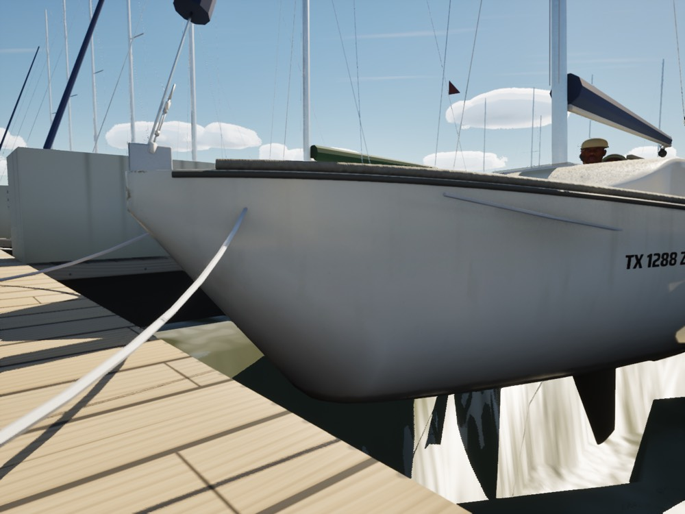
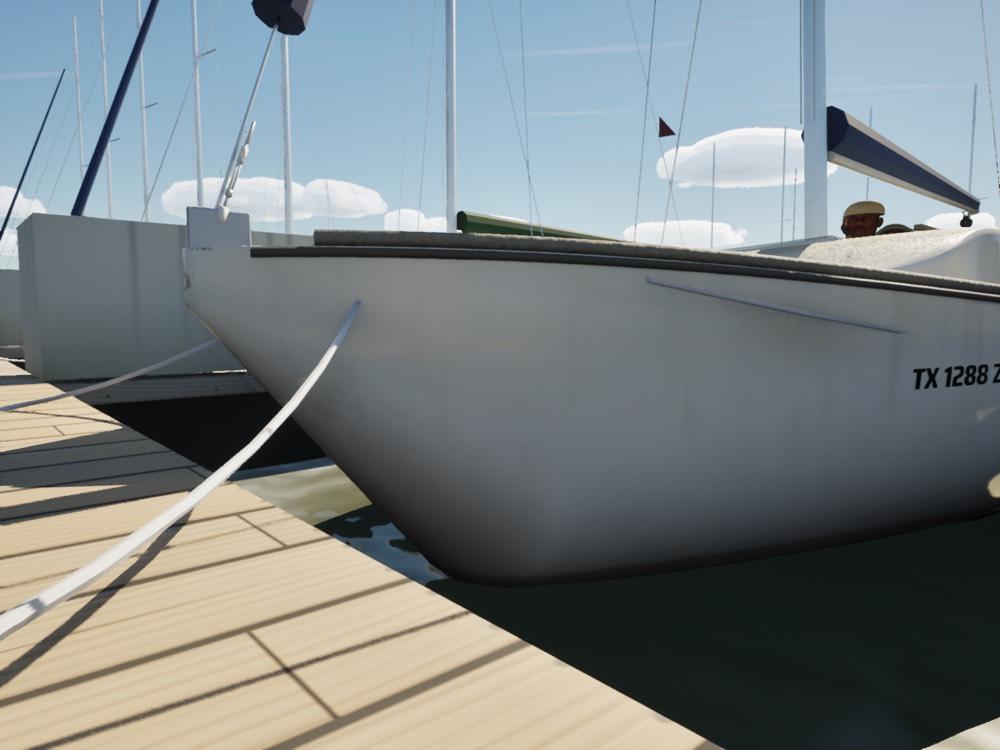
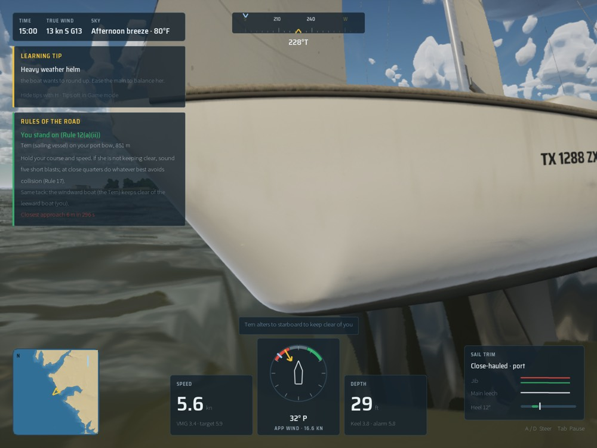
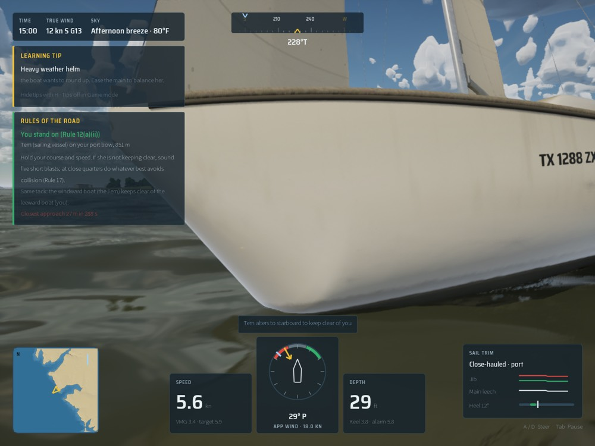
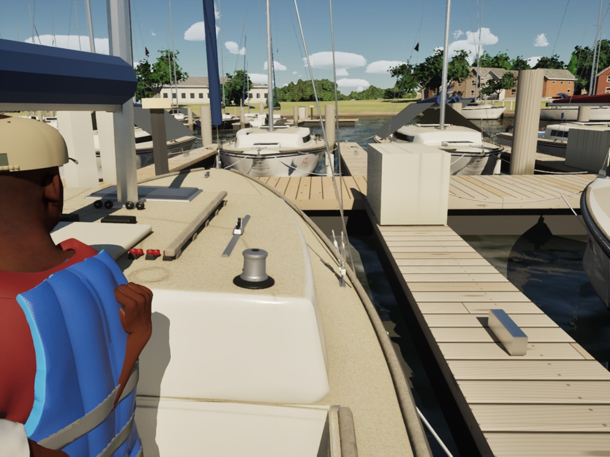
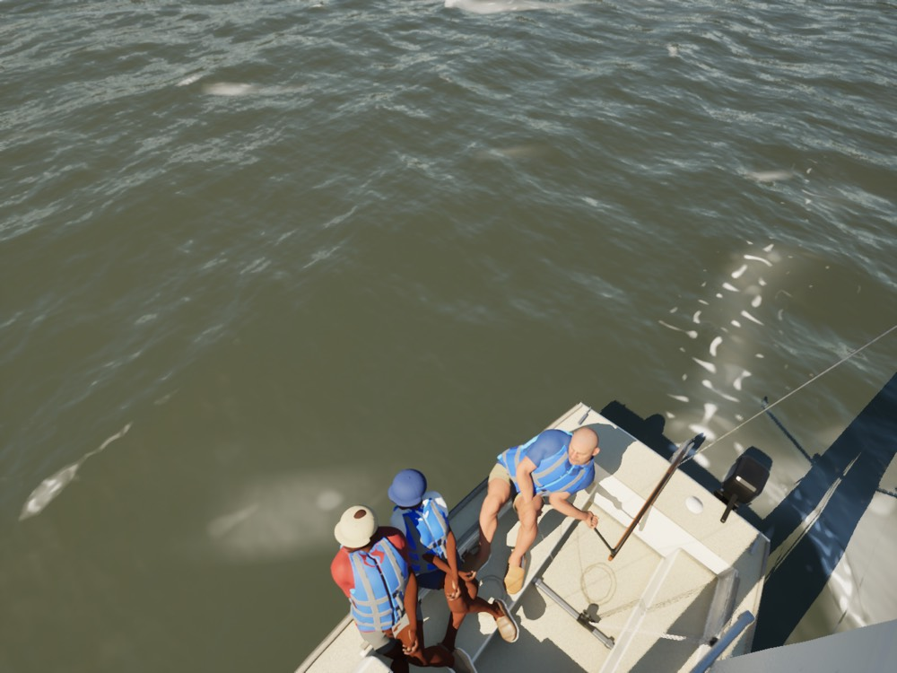
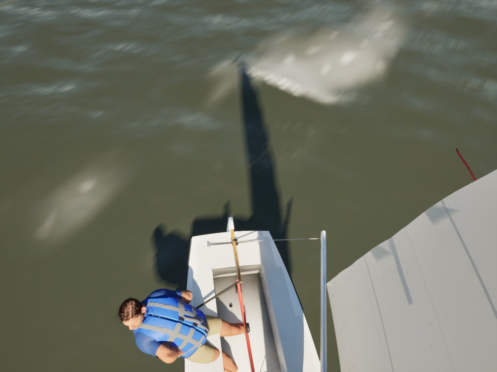

# Water under the hull (Oct 18 2026)

**The problem.** To keep the drawn sea out of the player's cockpit, `M_WaterV4` (Visual V7) dropped the water 2 m
over 80% of the hull's *deck* plan (`FHullShape`, from `BowX - 0.3` to `SternX + 0.2`). The deck plan runs well past
the waterline: the J/22's bow overhang reaches 0.7 m forward of the waterline, and forward the deck is wider than the
waterline. There the drop lay in open water beside and ahead of the hull, so from a low camera (the dock still in
`docs/licences/hero-registration-game.jpg`) the bow floated over a pit whose walls refracted the hull and the keel.

**The fix.** The water drops only where it is inside the hull: below the deck and above the hull's bottom
(`FHullShape::BottomZ`, evaluated per water vertex in the hull's own frame, heel and pitch included). There it drops
1.1 times its immersion (plus 3 cm, faded in over the first 5 cm), to just under the bottom, capped at 2 m. Outside the
hull, and under the overhangs where the bottom is above the water, nothing changes. The drop is zero where the water
meets the skin, so there is no seam, and the dropped water stays behind the hull's own opaque skin from every camera.
Water over the sheer (a knockdown) still drops inside the gunwale, faded over its last 15 cm.

`AWaterSurface::UpdateHullClip` now passes the hull's frame (origin and its three axes) and the full `FHullShape`
(eight vectors, `HullClipA`..`H`). `-SailingClassicHullClip` brings back the V7 clip for comparison. Only water
vertices within a hull length of her origin run the hull maths (a branch; without it every ring vertex paid for it).

## Stills

| | V7 (before) | Hull bottom (after) |
|---|---|---|
| Dock, low beside the starboard bow |  |  |
| Beating, 12 deg heel, low beside the bow |  |  |
| Cockpit view at the dock |  |  |

Cockpits stay dry heeled, looking down into them at 16 kn true, 45 deg TWA: J/22 
and ILCA 7 .

Dock: `scripts/run-game.sh 6 -SailingDrill=LeavetheDock -SailingKeepStart -SailingHour=11 -SailingNoHud
-SailingQuality=High -SailingCamTarget=1.85,0.9,0.45 -SailingCamDist=3 -SailingCamYaw=100 -SailingCamPitch=-5`
(cockpit: `-SailingCockpit` in place of the camera args). Heeled: `-SailingWind=16 -SailingTWA=45 -SailingHoldTWA=45
-SailingCamDist=4 -SailingCamYaw=150 -SailingCamPitch=-40` (ILCA: `-SailingBoat=ILCA -SailingCamDist=3.5
-SailingCamYaw=-160 -SailingCamPitch=-50`). The beating pair has the HUD on (a run without the dock args).

Limits: the clip follows the physics hull, not the drawn model. Where a model's skin lies inside the physics bottom
the water there dips by at most 1.1 times the gap (none seen on the hero J/22). Only the main hull is clipped, and
catamarans (two hulls) are still left alone.

## Gate (water scope, High plus storm on Medium)

Main c9e6fa9c and this branch, packaged and benched back to back
([gate-water-main.csv](gate-water-main.csv), [gate-water.csv](gate-water.csv)):

| view | main fps | fix fps | water GPU ms main / fix |
|---|---|---|---|
| beam8 High | 61.6 | 61.8 | 2.89 / 3.13 |
| beat15 High | 60.0 | 59.6 | 3.12 / 3.27 |
| storm High | 44.5 | 44.3 | 2.49 / 2.84 |
| marina High | 59.5 | 58.5 | 3.00 / 3.19 |
| coast-day High | 53.1 | 53.0 | 2.94 / 3.18 |
| gulf-sea High | 67.5 | 66.6 | 3.07 / 3.17 |
| helm-eye High | 57.9 | 57.4 | 2.39 / 2.34 |
| bridge High | 63.2 | 62.3 | 3.31 / 3.47 |
| storm Medium | 65.7 | 65.0 | 2.24 / 2.36 |

The fix costs 0.1 to 0.35 ms on the water slice (about 0.2 ms, under 1 fps). Storm High is under its 45 fps floor on
**main too** (44.5; 44.4 again run alone): this evening's full sweep had it at 50.2, and the extra time is in the
clouds (7.2 ms then, 9.6 now), not the water. That is a separate regression or a change in the machine's state, to
look at before this merges.
