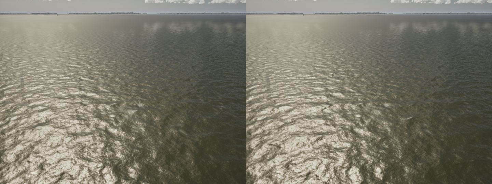
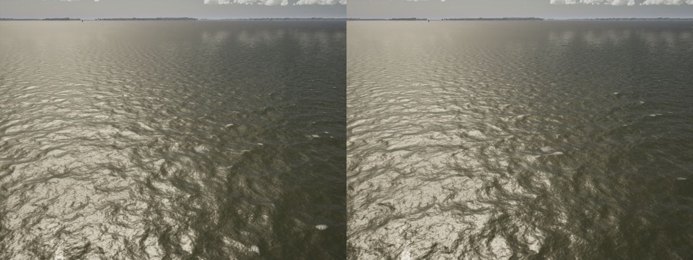
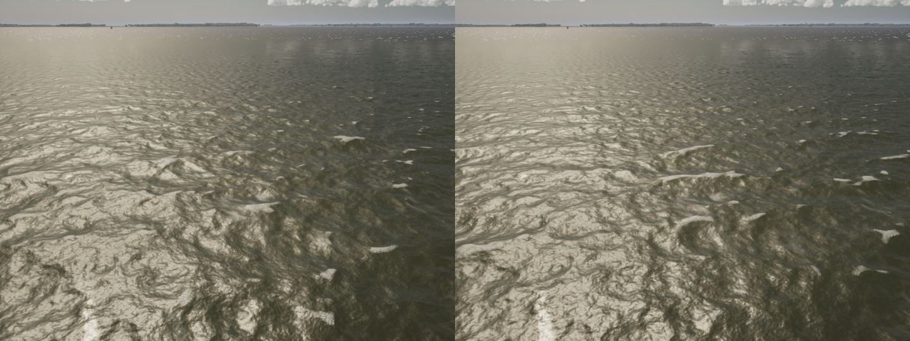
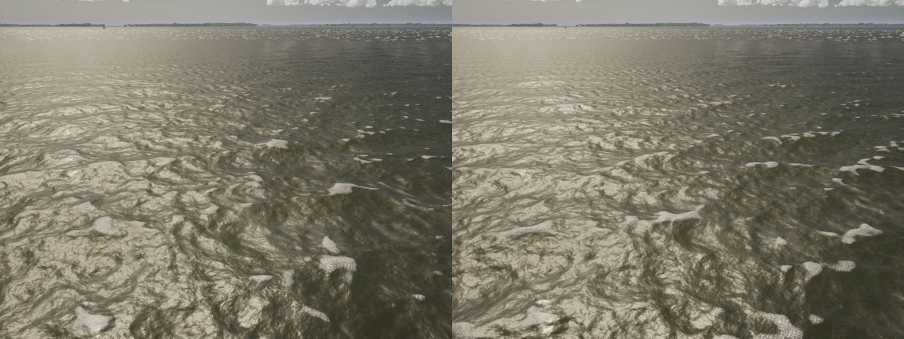

# Long waves stop weaving (storm-water step 2)

**Before:** the anchored sea's 24 long trains (8 bands x 3 directions under the 0.72 Hz split the renderer draws) were
laid at -Delta, 0 and +Delta about the wind in every band, each jittered by up to 3 deg (`FWaveField::AnchorDirections`).
Every band crossed the next at nearly the same angles, so at 20 kn and over the sea showed one diamond weave.

**Now:** each band's three directions are drawn from the measured spreading (Donelan-Hamilton-Hui sech^2, Banner past
1.6 fp), one in each third of its probability. That is stratified, so the band keeps the spreading's width. Each draw
lands about its third's middle, at random within the middle 60%. The sech^2 CDF inverts in closed form.

- **Weights:** each component carries the density it was drawn at. After a wind shift (under 45 deg, no re-laying),
  `ComputeTargetAmplitudes` weights it by the spreading now over that density, so the weights stay equal while the wind
  holds.
- **Unchanged:** frequencies were already random within each band, and phases random. The calibration sea (polars,
  sea trials, reference checks) keeps the constructor's directions and is unchanged.
- **Physics and render:** both read the same components, so the boat still floats on the drawn surface.

**Test.** `SailingSim.Physics.WaveSpreading`, rewritten for the drawn layout:

- **Thirds:** every direction lies in its own third of its band's spreading (0 of 48 outside).
- **Bands differ:** the middle directions spread from -7.9 to +6.0 deg off the wind across the bands. Before, all were
  within 3 deg of it.
- **Width:** the energy-weighted mean cos about the wind is 0.911, longer-crested than the calibration sea's 0.857.
- **Shifts:** a 30 deg shift only reweights, a 60 deg one re-lays with the surface unmoved at the hold point, and Hs is
  kept.

The `SailingSim.Water` tests, `Visual.WaveMatch` and `Physics.PolarGate` pass.

**Stills** (lake, High, 13:00, an elevated camera looking downwind; before left, after right), at 15, 20, 28 and 35 kn:

The change is in the long trains' crossing pattern, which reads mostly in the middle distance. The near water's
texture, and the caps' 23 m repeat, are the short waves' FFT tile: that is step 4.
