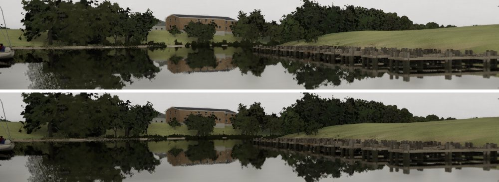
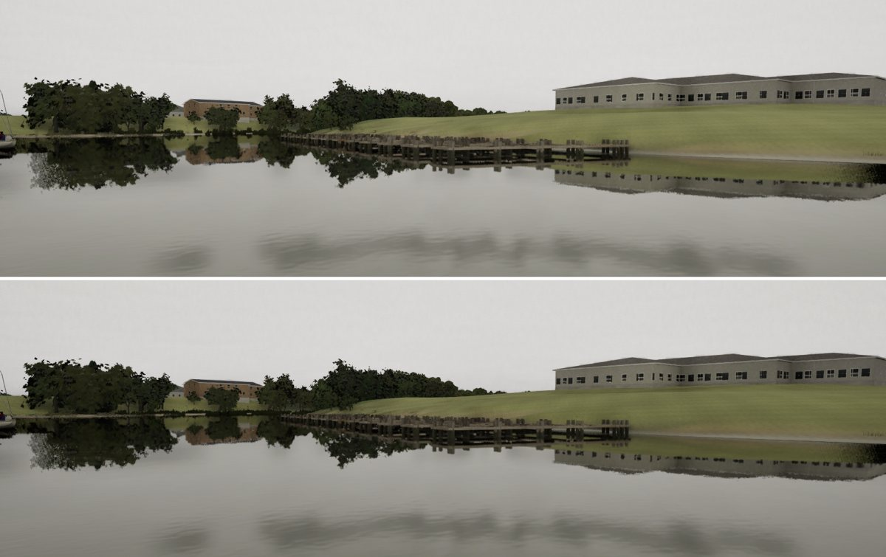

# Weed tops (#285's nit)

The Mac's gate on #285 noted that a few of the mid-bank far weed strips (`SM_Reeds_4`) read with flat, boxy tops.

## Cause

There were two causes:

- **The mesh:** the cards' peaks zigzagged every 25 cm. At 150 to 400 m that is under a pixel, so the strip's top read
  as one flat line.
- **The material:** `M_FarWeed`'s gaps came from a 1.7 m world grid, so each clump was cut square at both ends. Together
  the two read as boxes.

## Change

- **`build_reeds.py`, `far_margin`:** each long card's peaks now rise and fall in clumps a metre or two long (two sine
  envelopes with random phases per card), with a taller stem about one peak in twelve. There are 30 segments where there
  had been 18, so the strip is 488 triangles (it was 344).
- **`make_materials.py`, `build_far_weed`:** the gaps come from smooth value noise along the strip, against a threshold
  that rises with height (0.22 at the foot, 0.67 at 1.6 m). Each clump narrows to a ragged top, and the gaps open upward.

## Cost

GPU total (1920x1080, the sum of the bench's GPU slices):

| View | Tier | Before | After |
| --- | --- | --- | --- |
| g5-shore | Medium | 11.32 ms | 11.95 ms (strips not drawn on Medium) |
| g5-shore | High | 13.85 ms | 13.76 ms |
| g5-shore | Ultra | 18.57 ms | 18.28 ms |
| cove | Medium | 11.23 ms | 11.24 ms |
| cove | High | 13.65 ms | 13.83 ms |
| cove | Ultra | 16.85 ms | 16.67 ms |

The differences are within run-to-run noise.

## Stills (High; before above, after below)

