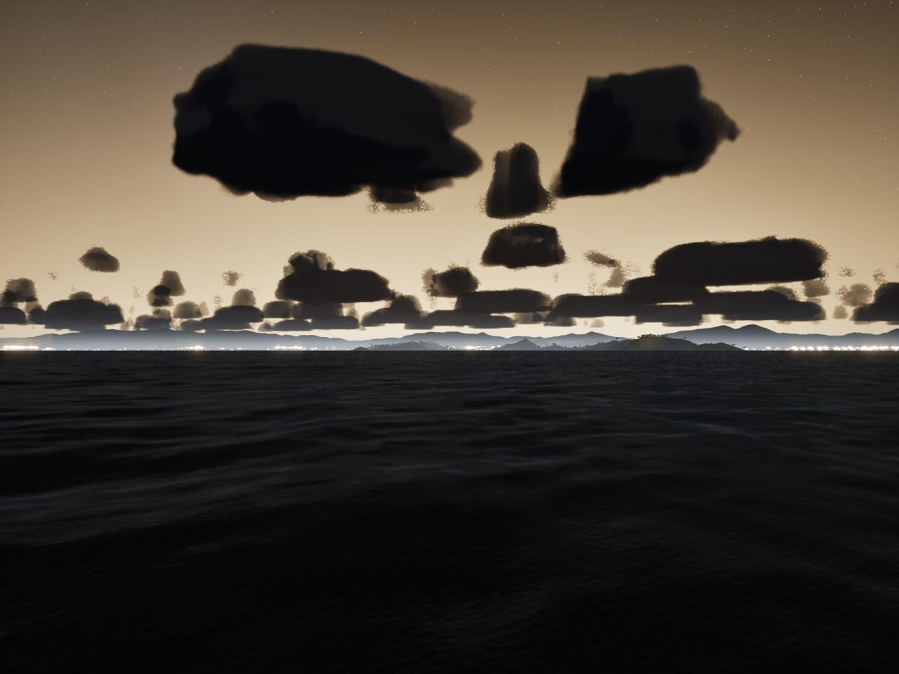
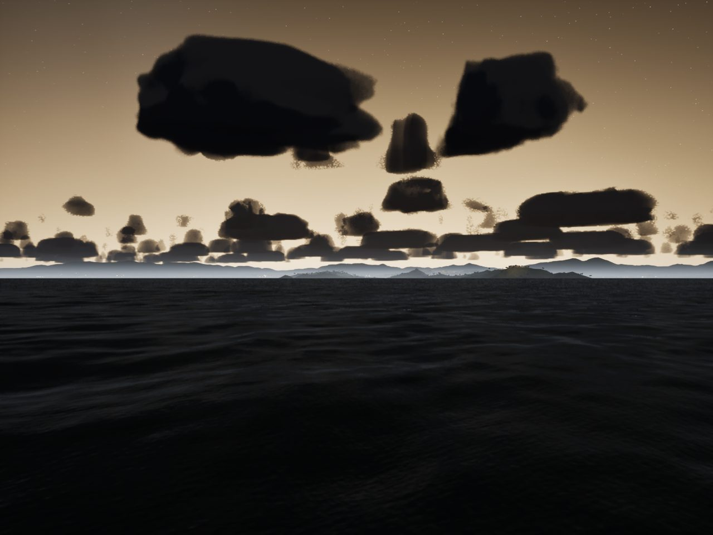
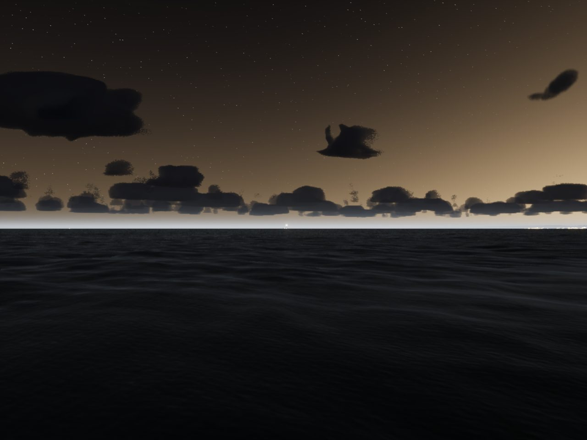

# Far lights (Wide World Rendering PR 3)

What a world shows at night beyond its near lights: lighthouses and lit navaids at their charted range, the lit shore
of the towns, the glow of up to four cities over the horizon, and ships on the shipping lanes.

## Pieces

- **Bake** (`Tools/terrain/build_far_lights.py [World ...]`, about 2 s for the four worlds) writes
  `Content/TerrainData/<World>.farlights.json`:
  - `lights`: every lit navaid the world charts, plus the lights around it out to the far ring's radius. Galveston Bay
    and the Gulf passage see each other's charted lights; Marseille's come from NGA Pub 113 (Cap Couronne, the Fos
    approach, Cassidaigne, La Ciotat). Marseille: 120 (54 charted here, 66 from beyond); Galveston Bay 294 (28
    beyond); the Gulf passage 339 (164 beyond).
  - `shore`: the houses bake binned to 100 m cells (Marseille 4,478, Galveston 9,238, the lake 5,443).
  - `cities`: the domes, from the world json's `city_glow` (Marseille, Aubagne, Cassis, Aix, Martigues, La Ciotat;
    light = (population / 2.3 M)^0.8, Houston being 1) or, for the Texas worlds, the list that was hard-coded in
    `SailingEnvironment.cpp` plus Galveston and Pasadena.
  - `lanes`: shipping lanes for the horizon ships (the world json's `ship_lanes`: Marseille's Corsica ferries, the
    Fos approach and the coastal route; the Galveston and Freeport fairways).
- **How far a light is seen** (`FFarLightMath`, `Source/SailingPhysics/Public/FarLights.h`): the nominal range fixes
  the luminous intensity (the night threshold of 0.2 microlux at 10 nm of visibility, IALA); Allard's law gives the
  illuminance through tonight's visibility, E = I T^d / d^2 with T = 0.05^(1/V); a light past its geographic range,
  2.08 (sqrt h + sqrt H) nm, shows only its loom, a dim glow just over the horizon.
- **`AFarLightsActor`**: past `NearPoolM` (6 km) it draws every light by that rule, with its charted character
  (`Lights.h`); inside 6 km `ANavaidsActor` draws a world's own navaids (with the buoys' heave), never both. The lit
  shore shows from 2 to 30 km as small emissive cubes sized by the cell's houses, re-placed when the camera moves
  150 m. Horizon ships are box impostors with a masthead light from 40 km in to 8 km; inside 8 km one joins the
  traffic as a ship on her lane (`ATrafficManager::HandOffShip`, when traffic is on). Everything sits on the
  curvature code's drop. `-SailingNoFarLights` compares.
- **City domes**: `M_SkyDome` draws up to four domes (`GlowDomesA`, `GlowDomesB`: azimuth and strength pairs);
  `ASailingEnvironment` takes them from the far-lights file, brightest first. The domes share the brightest one's
  light, so the sky is no brighter than the single dome made it; a dome is capped at Houston-from-Kemah.

## Measured (M5 Pro, packaged)

| View | Tier | GPU ms with | without | fps with | without |
|---|---|---|---|---|---|
| coast-night (Galveston) | Medium | 9.47 | 9.71 | 100.2 | 99.7 |
| coast-night | High | 14.29 | 14.17 | 64.1 | 63.7 |
| far-coast-night | Medium | 8.56 | 8.61 | 109.6 | 109.2 |
| far-coast-night | High | 11.60 | 11.44 | 77.7 | 77.6 |

About 0.1 to 0.2 ms on High, inside the 0.3 ms allowance (the second of two alternating runs; the first launch after a
build warms the shader cache and reads 50% slow across every pass). `scripts/gate.sh --scope night` and `--scope
world` pass, every High view over 45 (coast-night 63.9, marina-night 58.7, far-coast-night 78.2, marseille-port 56.9).

Tests: `SailingSim.World.FarLights` (Allard's law against the nominal range; Planier shows at 18 nm on a 25 km night,
not by day, not in 12 km of visibility, and only as a loom at 22 nm; every navaid's far light carries its own
character; none of the harbour's lights inside the near pool is drawn twice; the domes come from the world files).

## Gaps

- Sector lights draw their first sector's colour all round (the bake keeps the colours, not the arcs).
- Ships are boxes with one masthead light; side lights by aspect (`Rules.h`'s arcs) are a follow-up.
- The shore sprites come from the houses bakes, so they stop where the bake does (the far ring's coast beyond a
  world's box is dark until a far-tier buildings bake exists).
