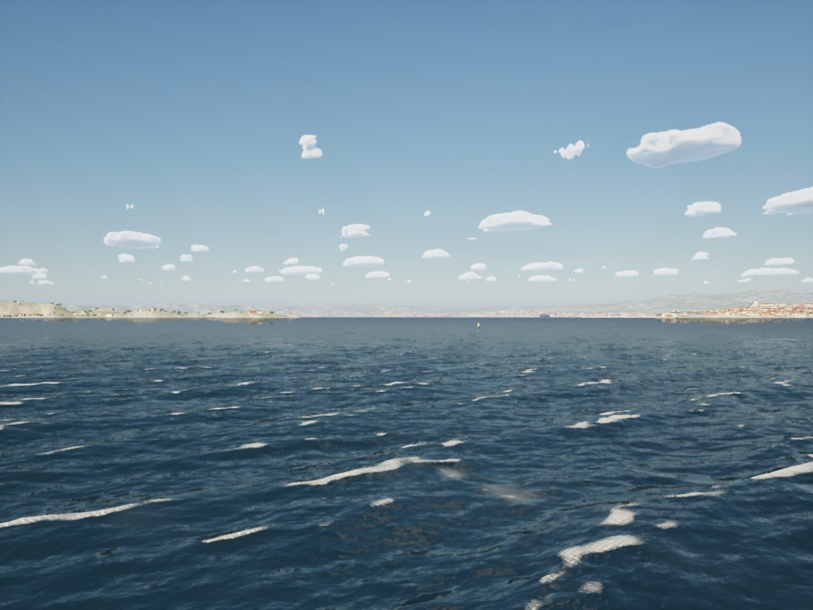
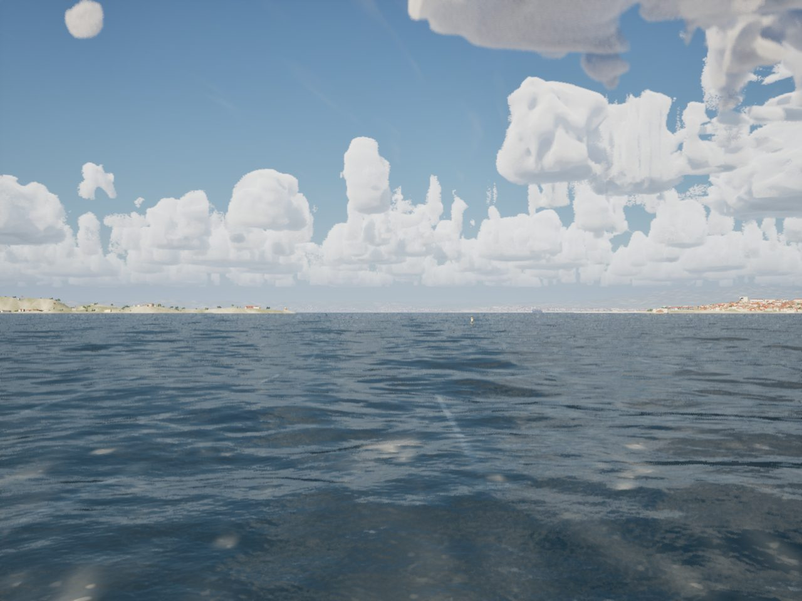
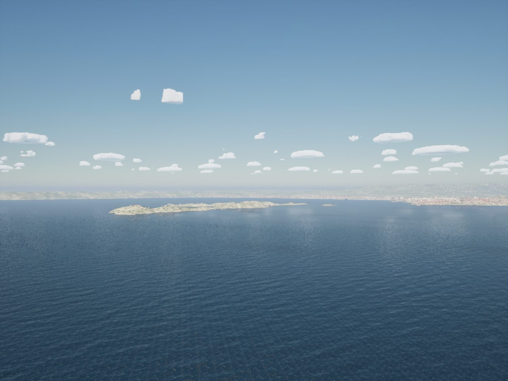

# Haze and far water (Wide World Rendering PR 4)

How far you can see, and what is out there: the haze at range, a clear mistral day, the water reaching the far coast,
and the mountains beyond the far ring.

## Haze

- **Visibility to 80 km.** The fog's density clamp stopped at 40 km (0.0015); a mistral day sees 60 to 80 km.
  `Sailing::FHaze` (`Haze.h`) holds the tuning the game already used (density 0.06 / V(km), Koschmieder's
  3.912 / extinction) with the clamp at 0.5 to 80 km. `SailingEnvironment::UpdateHaze` uses it.
- **Clear mistral** (`EWeatherPreset::ClearMistral`, `-SailingWeather=ClearMistral`): the mistral most days, dry and
  cloudless: 24 kn gusting 32 from the northwest (the world's prevailing direction when it gives one), 60 km of
  visibility, 14 C air with a 1 C dew point, a short 1.8 m wind sea. The prologue's `Mistral` gale with its squall is
  unchanged.
- **The haze's thickness per world** (`"haze": {"fog_scale_height_m"}` in the world json, read as
  `FLakeData::FogScaleHeightM`): Marseille's sea haze is a 400 m layer under the dry air; the Texas worlds keep the fog's
  50 m (falloff 0.2). Rain still mixes it up toward 200 m.

## Far water

- **The far plane per world** (`"far_plane_km"`, `FLakeData::FarPlaneKm`): 60 km across at Marseille, so the sea meets
  the far ring's hills and the mountains; 40 km on the Texas coast as before. The grid keeps its vertices per kilometre
  (44 per 40 km), so it follows the curvature as closely.
- The sea map atlas clamps to its edge texels beyond the grid, and the whitecap fold table's coarse mips average the
  cover, so the far water keeps the sea state at the grid's edge. Not changed here.

## Band D: the mountains past the far ring

- `Tools/terrain/build_skyline.py Marseille` (about 11 s) bakes `Content/TerrainData/Marseille.skyline`: the Copernicus
  GLO-90 tiles from 42 to 45 N, 3 to 8 E (`Data/Far/raw`, fetched like the far ring's) as block means on a 500 m grid,
  160 km around the Vieux-Port (641 x 641, 0.8 MB).
- `Sailing::FSkyline` (`Skyline.h`) marches it from the camera for the highest elevation angle per azimuth, from 45 to
  160 km, on the curvature code's earth. `ASailingEnvironment::UpdateSkyline` runs it on a worker every 500 m (7.8 ms
  for 2,048 azimuths) into a 2048 x 1 texture. `M_SkyDome` draws the land under that angle in front of the sky, the sun,
  the stars and the city glow, faded by the haze (contrast exp(-3.912 d / V)); the far clouds of the sky cache stay in
  front of it. `-SailingNoSkyline` compares. Texas has no skyline file (flat).
- What the physics allows: Mont Ventoux (1,909 m, 98 km north of the Vieux-Port) stands 0.68 degrees above the horizon
  after the earth's curve. At 60 km of visibility its contrast is 0.15%: it shows only past about 100 km of visibility.
  The clear mistral shows the far ring's hills sharply; the skyline is a faint band above them.

## Measured

Tests: `SailingSim.World.Haze` (visibility within 10% of Koschmieder from 1.5 to 80 km, the clamp at 80; the clear
mistral's 60 km, cloudless northwesterly; the far plane and haze layer per world) and `SailingSim.World.Skyline` (the
game's march within 0.016 degrees of a 100 m march over the same grid on 77 bearings with land past 45 km; Ventoux on the
skyline). Full suite 203/203.

Gates (packaged, High): `--scope world` passes (marseille-port 56.9 fps, coast-day 54.0, slip 53.2, stream-run 54.7, the
rest over 58); `--scope clouds` passes (storm 45.7 High, 66.2 Medium; beam8 63.6, gulf-sea 65.7). Against the same views
on #170's gate the frame times are within 0.1 ms: inside the 0.3 ms allowance.

## Gaps

- The sky atmosphere's own aerial perspective is unchanged (the height fog carries the haze); its distance scale per
  world is a follow-up if the far ring reads too blue or too grey at 30 to 60 km.
- The skyline is drawn in the sky dome from a 2048 x 1 elevation texture, not rendered into the sky cache's panorama;
  the cost is the same (no draws), and the cache's clouds composite over it.
- Mountains show only past about 100 km of visibility; a "crystal mistral" at 120 km would show Ventoux plainly.
