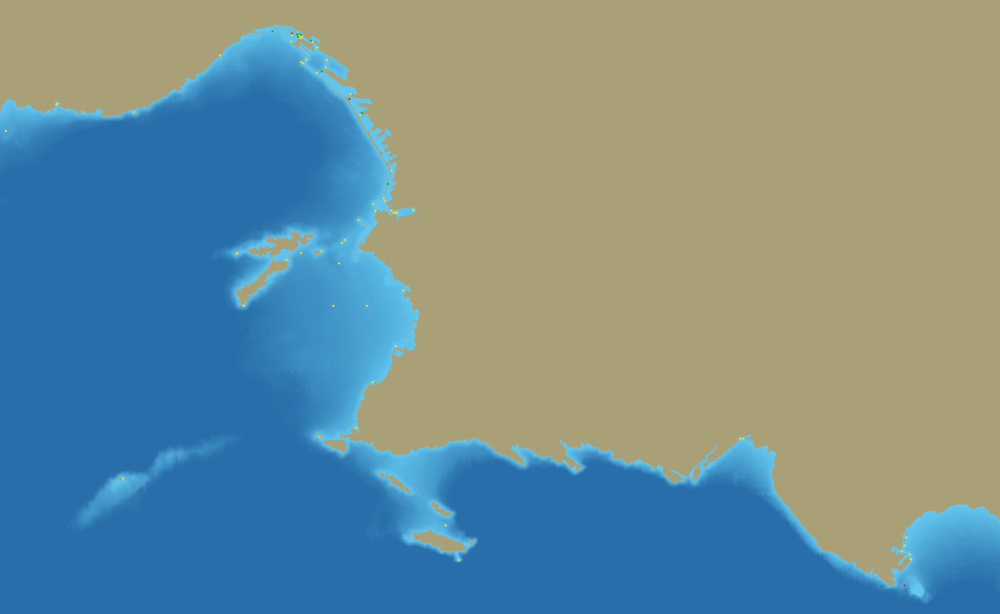
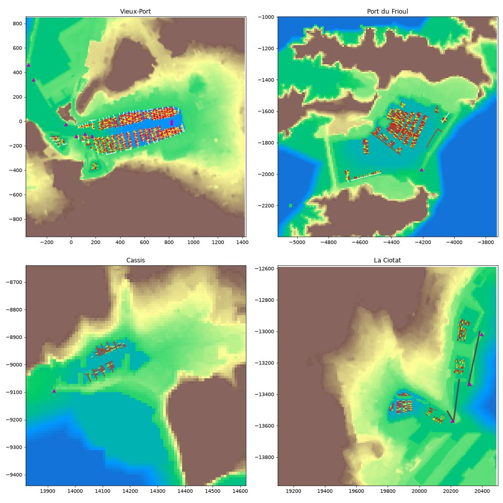

# Marseille: the port pipeline's first world

Marseille is the first world baked from a box and a name instead of NOAA charts: `Tools/coast/worlds/Marseille.json`
holds everything that is particular to the port (the box, the origin, the harbours and their depths, the datum, the
launch spots, the passage, the climate, the city glow and the far coast ring's sources), and the coast tools read it.

| | |
|---|---|
| Box | 5.17-5.66 E, 43.15-43.37 N: the Rade de Marseille, Frioul (If, Pomegues, Ratonneau), Pointe Rouge, Cap Croisette, Riou, the Calanques, Cassis and La Ciotat (Ile Verte), Planier |
| Origin | the Vieux-Port entrance (43.2950 N, 5.3625 E), X north, Y east, metres |
| Grid | 3970 x 2440 cells of 10 m (40 x 24 km); heights in 2.5 cm steps (int16 reaches 819 m: the Garlaban is 714 m) |
| Datum | NGF-IGN69, mean sea level at the Marseille tide gauge (the gauge that defines French levelling); MHW 0.15 m |
| Tides | none (spring range about 0.3 m): the water stands at the datum |
| Projection | tmerc on GRS80 (ETRS89, which WGS84 positions match to centimetres); `FGeoAnchor::ParseProj4` reads it |
| Buoyage | IALA region A (port red, starboard green): the bake fills missing lateral colours by region |
| Variation | 2.83 E, +7.1'/yr (NOAA WMM-2025, 2026-10-19) |



## Rebake

```
python3 Tools/coast/fetch_world.py Marseille                 # Data/Marseille/raw, about 8 min (Overpass waits between queries)
Tools/venv/bin/python Tools/coast/build_coast.py Marseille   # height, trees, json, chart: 25 s
Tools/venv/bin/python -I Tools/coast/build_piers.py Marseille     # piers, pontoons, breakwaters, moored boats: 1 s
Tools/venv/bin/python -I Tools/terrain/build_houses.py Marseille  # houses: 10 s
Tools/venv/bin/python -I Tools/coast/plot_harbours.py Marseille docs/world-marseille/harbours.jpg
```

The whole bake runs in about 40 s on the M5 Pro; the downloads are 481 MB (git-ignored; IGN's tiles 198 MB). The
pack in `Content/TerrainData` is 25 MB: `Marseille.height` 16.2 MB, `.houses` 3.8 MB, `.trees` 2.0 MB, `.chart.json`
1.3 MB, `.json` 1.1 MB, `.piers` 0.2 MB.

## Sources (all free for a sold game with credit; rows in docs/licences/assets.csv, credit in CREDITS.md)

- Land: IGN RGE ALTI 5 m (bare earth, NGF-IGN69, Licence Ouverte 2.0) through the Geoplateforme's WMS-R, twelve
  10 km tiles in Lambert-93 (`rgealti/*.bil` with ESRI headers). It covers all the land; Copernicus DEM GLO-30 stays as
  the fallback. data.geopf.fr does not resolve from the Mac's own DNS, so `fetch_world.py` asks Google's public DNS
  over HTTPS for its address and pins curl to it (Bean approved the fetch, Oct 19 2026).
- Sea bed: EMODnet Bathymetry DTM 2024 (1/16 arc-minute), trusted 180 m and more from the shore; harbours at their
  dredged depths (the world json's list); the shore pin is 2 m on rock and quays, 0 on OSM beaches.
- Coastline, harbours, piers, pontoons, breakwaters, seamarks, landmarks, land use, buildings: OpenStreetMap.
  OSM's seamark tags are S-57's own vocabulary, so `osm_chart.py` emits the same rows the ENC reader does and the rest
  of `build_coast.py` runs unchanged.
- Lights: NGA Pub 113. 39 of OSM's lights match a Pub 113 entry within 250 m (Pub 113's character wins), 7 more come
  from Pub 113 alone (Planier, the cardinals off Cap Mejean and Basse Saint-Esteve, ...).
- Far ring: Copernicus GLO-90 tiles N43 E004 and N43 E005 in `Data/Marseille/raw/far` (N42 is all sea), for the far
  coast ring and the skyline (Sainte-Victoire, Sainte-Baume, Garlaban, Etoile, Marseilleveyre, Cap Canaille). The ring
  itself is the rendering lane's work.
- No SHOM product (charts, Litto3D, tide tables) is used.

## What the bake holds

- 73 aids to navigation (54 lit), 244 landmarks (twelve named in the world json: Notre-Dame de la Garde, Chateau
  d'If, La Major, Fort Saint-Jean, Fort Saint-Nicolas, the MuCEM, the Pharo, the CMA CGM tower, Planier, the Caroline
  hospital, the Bec de l'Aigle, La Ciotat's shipyard cranes).
- 190 fixed piers in the world json; in `Marseille.piers` 64 pier decks, 41 breakwaters and groynes, 133 pontoons
  (8.3 km) and about 3,800 boats moored stern-to, Mediterranean style (Vieux-Port about 1,870, Frioul 770, La Ciotat
  330, Port de la Lave 290, Pointe Rouge 220, Cassis 75, Port-Miou 23). Boats also berth along the narrow fixed piers
  inside a harbour (Pointe Rouge's and Cassis's are mapped as untagged outlines).
- Cassis, the second port: its own slip (`cassis_slip` spot role) and harbour at 3.5 m. OSM's coastline wraps Cassis's
  piers as land, so the bake carves narrow pier outlines (and harbour basins mapped as water) back out of the land;
  only eight of its pontoons are mapped, hence 75 boats where the port has about 450 berths.
- About 84,000 houses within 1.5 km of the water (27,000 within 400 m at full detail): OSM's height, storeys, roof
  shape and colour where mapped, else the world's `house_style` (Roman-tile gables and hips at 20 degrees, two to four
  storeys, terracotta palette, blocks of six storeys and more flat).
- Shoreline: at 4,474 points every 50 m along the OSM coastline the terrain crosses mean high water within 5 m of the
  line at 89% of them and within 10 m at 97% (median 2 m) on the 10 m grid.
- Launch spots: the Vieux-Port (Quai de Rive Neuve, the home slip), the entrance, the Frioul anchorage, Pointe Rouge,
  the Rade Sud, off Sormiou, Cassis bay, the Port de Cassis (Cassis's slip), La Ciotat bay off Ile Verte, and the gale
  spot offshore past Planier. The passage: Vieux-Port, If, Cap Croisette, Riou, En-Vau, Cassis, Cap Canaille, La
  Ciotat.



## Harbour kit the port needs (for the PC's model lane)

Counts from the bake and OSM; the first column is the model to build, the last where it goes.

| Model | Count | Where |
|---|---|---|
| Rubble-mound breakwater with a wave wall (Digue du Large type) | 1 long run, 4.5 km of riprap in all (34 pieces) | the Joliette and the Rade Nord, Pointe Rouge, Frioul |
| Quay wall in dressed stone, with bollards and rings | the Vieux-Port's three quays, about 2.5 km of harbour edge | Vieux-Port, Frioul, Cassis |
| Floating pontoon (2.5 m) with finger-less stern-to berths and lazy-line rings | 133 (8.3 km) | every harbour |
| Fixed concrete berthing pier | 64 decks | Pointe Rouge, Cassis, Frioul |
| Harbour light towers (white with red or green tops) | 37 lights, 11 lighthouses | entrances, mole heads |
| Major lighthouses | 3: Planier (68 m), Chateau d'If light, Pointe de la Desirade | |
| Port cranes (container and ship-to-shore) | 23 | the Grand Port Maritime (north) |
| Forts and towers | Fort Saint-Jean (Tour du Roi Rene, Tour du Fanal), Fort Saint-Nicolas, Chateau d'If, Fort de Ratonneau, Pomegues batteries, Batterie de Croisette | entrance and Frioul |
| Landmark buildings | Notre-Dame de la Garde, Cathedrale de la Major, MuCEM, Palais du Pharo, Tour CMA CGM, Hopital Caroline | skyline |
| Marseille town houses (trois-fenetres, 3-4 storeys, tile roofs) | most of the 84,000 houses: an archetype set, not one each | the city |
| Calanques limestone cliff and scree material | the whole south coast | Calanques |

## Gaps

- The 1 m shore detail (`.detail`) needs RGE ALTI 1 m (or LiDAR HD) and is not baked yet.
- Harbour depths are the world json's dredged depths, not surveyed ones; EMODnet does not resolve the harbours.
- No tree crowns (no lidar canopy yet): trees come from the OSM land-use density map (`tree_density` in the json).
- Moored boats are laid along the pontoons, not observed; two small harbours (Vallon des Auffes, Roucas Blanc) map no
  pontoons and have none.
