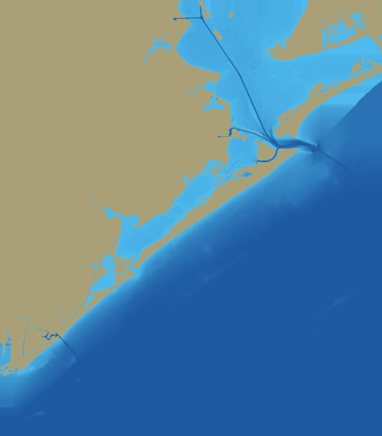
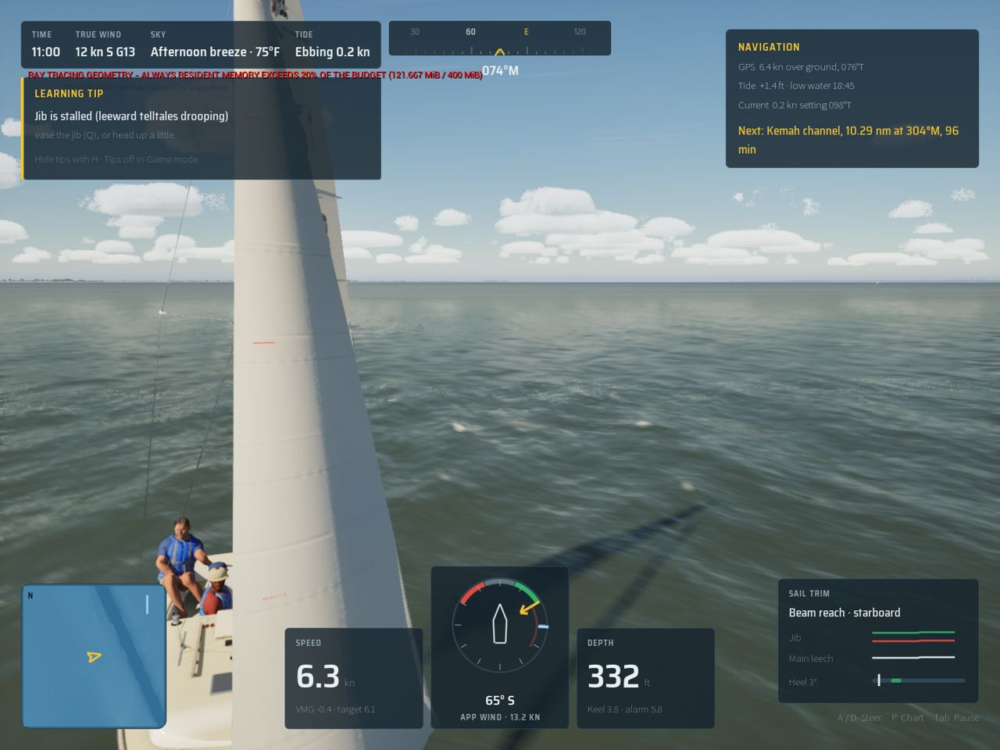
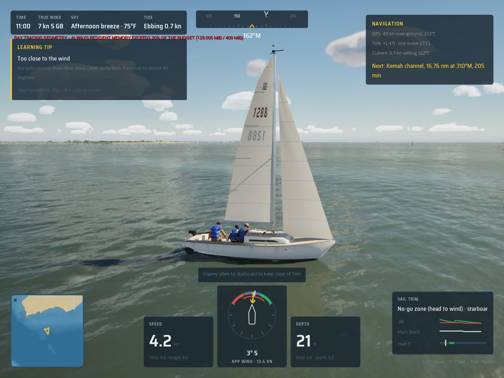

# World streaming (Wide World Rendering, PR 2)

## In plain English

The game no longer has to load a whole world at once, and it no longer draws everything around a fixed point.

- **The Texas coast is one place now.** Galveston Bay and the Gulf passage are joined into a new world, "The Texas
  coast", 105 km from Clear Lake to Freeport. You can leave Kemah, run down the ship channel, go out through Bolivar
  Roads and the jetties and on along the beaches with no loading screen on the way. The old Galveston Bay and Gulf
  passage worlds are still there and behave as before.
- **The ground arrives in tiles.** The coast's heights are cut into 6.4 km squares. A background loader reads the ones
  within 26 km of the boat, nearest first, one at a time, and lets go of those more than 32 km behind. The terrain you
  see is built from whichever tiles are in. The game's main thread spends about 0.002 ms a frame on this. In the test
  sail it never took more than 0.08 ms in a frame.
- **The drawing frame follows the boat.** Graphics cards draw in single precision, which gets coarse far from the
  centre of the world. So when the boat is 20 km from the centre, the game moves the centre to her in one frame. Boats,
  wind, waves and tides are worked out in their own frame, which never moves, so none of them notice. The test sails a
  boat through the move and back: she ends up in exactly the same place, at the same speed, as without it (0.000 mm
  and 0.000 mm/s apart).
- **The sea's physics follows too.** The fetch, swell shelter and wind shelter used to be worked out over the whole
  world at load time. On a streamed coast they are worked out over a 48 km square around the boat, in the background,
  and again when she leaves its middle. Near the boat they give the same answers as the whole-world version: shelter and
  swell exactly, fetch within 2.8%.
- **Cost:** every world view still passes the gate (High 45 fps, Medium 60 fps). The new streaming view, which slides
  the world under the boat at 40 m/s so that tiles, chunks and the drawing centre all change during the 12 s it is
  measured, runs at 54.7 fps on High and 85 fps on Medium.
  - The one visible cost is the frame in which the drawing centre moves: about 56 ms on High instead of 18 ms, once
    every 20 km. That is under a minute of sailing at 40 m/s, and about an hour and a half at 7 knots.
  - Almost all of that frame is the engine moving the scene on the render thread. The game's own part is 0.3 ms.

## How it works

### The bake (`Tools/coast/compose_world.py`)

`Tools/coast/worlds/TexasCoast.json` lists its members (`"compose": ["GalvestonBay", "GulfPassage"]`) and the one whose
map frame it keeps (`"frame": "GalvestonBay"`). `Tools/venv/bin/python Tools/coast/compose_world.py TexasCoast` (or
`build_coast.py TexasCoast`) takes about 10 s:

- **`TexasCoast.tiles`:** 224 tiles of 6.4 km on a lattice that starts at the bay grid's origin.
  - The 72 tiles over the bay grid are 10 m. Where a tile lies wholly inside the bay grid it holds the bay's own nodes,
    byte for byte.
  - The 152 other tiles are 50 m, taken from the Gulf passage, which is reprojected with pyproj (its tmerc to lat/lon to
    the bay's tmerc).
  - The two blend over the last kilometre inside the bay grid's edge.
  - Where neither member has data, the ground comes from GLO-90. Land is land at its height. Sea gets the depth of the
    nearest known water, so the Bolivar Peninsula and East Bay run on past the bay's bake and the Gulf runs on past the
    passage's chart.
  - Format: a 48-byte header and one 40-byte entry per tile, then each tile's zlib-compressed int16 heights in cm
    (`FTileIndex` in `Source/SailingPhysics/Public/WorldStream.h`).
- **`TexasCoast.json` and `.chart.json`:** the bay's metadata and chart, plus the passage's launch spots, navaids,
  landmarks, docks, bridges, tide stations and chart features where they fall outside the bay grid. Launch-spot headings
  and building yaws are turned by the 0.16° between the two grids' norths.
  - The passage runs from the Kemah channel to the Freeport entrance.
  - `"members"` names the files the game reads from the bay in place: houses, lidar crowns, piers, tidal current and
    the baked bridge and shore tiles. No copies are made.
- **`TexasCoast.trees`:** the bay's 20 m density grid, extended over the lattice with the passage's.
- **Far ring and far lights:** `scripts/make-far-ring.sh TexasCoast` (`build_far_ring.py` now reads a tiled world) and
  `build_far_lights.py TexasCoast` (it reads the houses from the frame member).

### The game

| Piece | What it does |
| --- | --- |
| `FTileIndex`, `FTerrainTile`, `FTileSet` (SailingPhysics) | The index, a tile's heights, and the resident set as an immutable snapshot. `FLakeTerrain` holds either one whole grid or a tile set. Everything big is held by shared pointer, so a copy is cheap: workers take a copy and the game thread can swap tiles under them. |
| `FLakeTerrain::WindowAround` | A view of the same heights clipped to a square around a point, with its corner on a 200 m lattice so the grids built on it line up with the whole world's. The sea fetch, ocean mask and shelter map are built over it unchanged. |
| `PlanStreaming`, `FStreamRadii` | Load within 26 km (nearest first), drop past 32 km. The gap stops a tile on the edge from coming and going. |
| `FWorldStreamer` (game) | Reads the index at start, reads the tiles within 26 km of the launch spot on every core (51 tiles in 7 ms), then one tile at a time on a worker as the boat sails. The game thread only plans, takes what arrived and publishes a new snapshot. A whole-grid world gets an index over its grid (`FTileIndex::ForGrid`) with every tile resident. |
| `NeedsRecentre`, `ASailingGameMode::RecentreAt` | When the boat is 20 km from the render origin it moves to the 19.2 km lattice point nearest her, via `UWorld::SetNewWorldOrigin`. 19.2 km is three tiles and a whole number of the water's 480 m and 60 m detail tiles, so nothing periodic in the materials jumps. A launch spot past 20 km (Bolivar Roads, the Gulf's offshore spots) starts on the lattice point before any actor begins play. |
| `SailingFrame.h` | Map metres to Unreal and back (`ToWorld`, `ToMap`, `ToMapCm`, `FromMapCm`, `ToWorldTransforms`, `MapAnchor`). Every place that turned map metres into Unreal positions or back goes through these now: the boats, traffic, marks, spray, exhaust, rain curtains, lightning, the weather map, lights, landmarks, bridges' traffic, the marina, trees, houses and docks. |
| `MPC_World.RenderOrigin` | `make_materials.py`'s `node()` adds it to every world, camera and object position a material reads. Materials therefore work in the map frame: wave phases, wind and sea maps, the weather map and world-aligned patterns all carry on through a re-centre. |
| The physics' window | On a streamed world the sea fetch, ocean mask and shelter map are marched over 48 km around the boat on a worker. That happens again when she is 8 km from the window's centre, at each re-centre, and when the swell changes; the new grids are swapped in when done (1.1 s on a worker). |
| `ALakeTerrainActor` | Chunks are keyed by world tile: five a side on a 10 m tile, one on a 50 m tile. They are made within the near cap (8 km with the far ring) plus a chunk, dropped 4 km past it or when their tile goes, and built from the tile's own nodes. Far-ring tiles are loaded within 48 km of the camera and dropped beyond 56 km. On a streamed world each new tile's trees are placed on a worker, and trees past 9.5 km leave the instance components. |
| `SSailLoading` | Two new stages: "Reading the far coast" (the far ring's tiles within reach) and "Marching the sea" (the physics' window). |

On a streamed world the near tiles are read in `InitGame`, before anything starts. Nothing in SailingPhysics assumes an
origin: the physics stays in the world's map frame in doubles. Freeport is 75 km from the bay's origin, which is
1e-11 m of precision. `FGeoAnchor` gives lat/lon beside it.

### Measuring

- `-SailingWorld=TexasCoast` (or `4`, or the World screen's fourth card) picks the new world.
- `-SailingRun=<m/s>,<bearing>[,<turn after m>]` slides the world under the player's boat. She sails as she would (her
  velocity, the water and the apparent wind are her own) while her position runs along the bearing, out and back. She
  leaves terrain contact behind, so the HUD's depth reads deep.
- The `stream-run` bench view (`bench-visual.sh`, in `gate.sh --scope world`, and in `views.ps1` for the PC) starts
  19.55 km from the origin at 40 m/s. It crosses a tile boundary about 7 s in, and the re-centre falls inside the
  measured window.
- `scripts/soak-streaming.sh [seconds] [m/s]` runs the soak.
- Every bench.json now has a `world` object: tiles resident, MB, loads, drops, the loader's longest call, re-centres
  and the longest, window marches, chunks made and dropped, and far tiles dropped.

## Measured

Oct 19 2026, Bean's Mac (M5 Pro), packaged Development build.

### Tests (`SailingSim.World.Streaming.*`, all pass; the whole suite: 201 of 201)

| Test | Result |
| --- | --- |
| Rules | Re-centre past 20 km to the nearest lattice point. An index over a whole grid covers it, and its tiles are the grid's nodes (within 1 cm). The plan loads nearest first and drops nothing inside the keep radius. A window reads the same heights. |
| Sail: Kemah → ship channel → Bolivar Roads → the jetties → Galveston beach → San Luis Pass and back, 206 km at 10 m a frame (40 times a boat's speed, the worker keeping up a read a frame) | The tile under the boat was always resident, and so was every tile within 2 km. 274 loads and 213 drops. The worst game-thread tick was 0.08 ms. Back at the start, nothing past the keep radius is resident. Inside the bay grid the heights are the bay's (within 1 cm). Offshore they are the passage's at the same lat/lon (within 0.02 m). Start: 51 tiles, 34 MB, read in 7 ms. Most on the way: 53 MB. |
| Windows, at Bolivar Roads over 272 water points within 8 km | Sea fetch within 2.8% of the whole world's, ocean mask and shelter exact (0.000). The window's fetch marches in 80 ms against 350 ms for the whole coast. |
| Re-centre (a J/22 sailing, the origin moved 19.2 km north and east at 2 s) | Her place and velocity after 4 s are the same as without it (0.000000 m and m/s apart). Her actor is where her physics is, in the new frame. |

### Gate (`scripts/gate.sh --scope world`, High; then `stream-run` on Medium)

| View | High fps | p99 ms | GPU ms |
| --- | --- | --- | --- |
| marina | 61.4 | 17.31 | 15.62 |
| coast-day | 53.8 | 19.82 | 17.58 |
| coast-night | 64.6 | 19.66 | 14.33 |
| helm-eye | 60.0 | 21.33 | 15.42 |
| slip | 53.4 | 20.0 | 17.98 |
| bridge | 65.7 | 16.81 | 14.35 |
| marina-night | 58.4 | 19.98 | 15.85 |
| far-coast | 63.0 | 17.63 | 14.46 |
| far-coast-night | 79.0 | 15.32 | 11.39 |
| marseille-port | 57.5 | 21.67 | 16.51 |
| **stream-run** | **54.7** | 20.56 | 17.3 |
| **stream-run, Medium** | **85.0** | 12.42 | 11.33 |

The stream-run view on High:

- One re-centre (0.29 ms of game thread) and one window march (1.1 s on a worker).
- 68 tiles resident (48 MB).
- 523 chunks made and 279 dropped during the run.
- Game thread 3.1 ms (streaming 0.002 ms a frame).

Its frame trace has one spike: the re-centre's frame at 56 ms. The engine shifts every primitive, its virtual shadow
pages and the Lumen scene on the render thread. The 170-200 ms `max_ms` in every view's bench.json, streaming or not,
is the end of the bench.

### Soak (30 min, High)

`QUALITY=High scripts/soak-streaming.sh 1800 25` runs the world sliding under the boat at 25 m/s, out and back over
40 km. The leg runs from Kemah down the bay, through Bolivar Roads and out past the jetties. The baseline is the same
view parked at Kemah (`... 1800 0`). Memory is macOS's footprint for the game's process, every minute, in
`soak/*-footprint.csv`. The first run sampled `ps` RSS instead, which macOS's compressor dropped from 4.3 to 1.1 GB at
12 minutes while the game kept running, so it says nothing.

| 30 min, High | Running (25 m/s) | Parked (baseline) |
| --- | --- | --- |
| fps, whole run | 58.1 | 49.8 |
| p99, first / last 10 min | 32.6 / 27.3 ms | 51.7 / 33.0 ms |
| p99 drift | -5.2 ms/h (none) | -61 ms/h (none) |
| Game thread, p99 | 3.1 ms, 6.1 ms (streaming 0.002 ms a frame) | |
| Footprint, 5 min to the end | 10.7 to 12.6 GB, **+4.2 GB/h** | 11.0 to 12.3 GB, **+2.7 GB/h** |
| What streamed | 102 tile loads, 32 drops, 70 resident at the end (37 MB). 1,004 chunks made and 783 dropped (221 at the end). 49 far tiles dropped. 4 window marches (0.8-1.6 s each on a worker). 1 re-centre. | |

Streaming's own state is flat: tiles, chunks and far tiles come and go and their counts return.

- A memreport at 5 and 20 minutes into a third, 20-minute run shows the UObjects flat (net -7 MB) and Metal's heaps flat.
- The 1 GB it grew in those 15 minutes is outside both, in the non-object heap. That is where the Mac engine's known
  leak lives (`docs/budget/mac-soak-high-2-2026-10-17.md`: Metal objects created every frame, and on every
  acceleration-structure build, that are never released). Parked, that leak is the baseline's 2.7 GB/h.
- Running adds about 1.5 GB/h on top. That is consistent with the extra mesh uploads and ray-tracing builds a moving
  camera causes (new terrain chunks, tree instances, far tiles).
- So the 10% target is not met on the Mac (+17% in 30 min running, +12% parked). The cause is the engine's undrained
  Metal objects, which the streaming makes more of, not data the streaming keeps.

### Pack sizes (the Texas coast's own files)

| File | Size |
| --- | --- |
| `TexasCoast.tiles` | 16 MB (64 MB of heights zlib-compressed) |
| `TexasCoast.trees` | 22 MB (the 20 m density grid over the lattice, uncompressed as the other worlds') |
| `TexasCoast.chart.json`, `.json`, `.farlights.json` | 7.0, 1.8, 0.3 MB |
| `TexasCoast.far` | 4.5 MB |
| `/Game/World/Far/SM_Far_TexasCoast_*` (285 Nanite tiles) | 34 MB |
| Houses, crowns, piers, current, kit tiles | 0: read from Galveston Bay's files in place |
| **Total** | **about 85 MB** |

## Known gaps

- **Memory grows on the Mac while sailing:** +4.2 GB/h on High at 25 m/s against +2.7 GB/h parked (the soak above). It
  is the engine's per-frame Metal leak, made worse by the extra uploads; the game's own streaming state is flat. It needs
  the same fix as the budget soaks' leak.

- **The re-centre's frame costs about 40 ms extra on High.** It is the engine's world-origin shift on the render
  thread, not the game's code. Once every 20 km it is a visible stutter. Worth profiling (virtual shadow map
  invalidation and Lumen's scene are the suspects) before a 60 fps target.
- **The Gulf's own structures are not baked for the Texas coast.** Its bridges and shore riprap use Galveston Bay's
  baked tiles, so the bay is unchanged. The passage's structures outside the bay grid (Freeport's jetties and San Luis
  Pass's bridge) fall back to procedural tiles until `make-world-models.sh` bakes them for TexasCoast.
- **The minimap and art are the bay's.** On the Texas coast the minimap shows the bay's map, so offshore beyond it the
  map is blank. The World screen's card reuses Galveston's pictures.
- **Career:** the Texas coast opens in Free Sail. Whether and when Career opens it is Bean's call; it is not in
  `career.json`.
- **Low tier trees:** the Low tier places its tree shapes once, around the start. Medium and up place their model trees
  tile by tile.
- **The density trees, houses, crowns and piers are loaded whole** (the bay's, at start) rather than per tile. Only the
  model trees' placement follows the tiles. On this coast that is a few MB of data, and the instances past 9.5 km are
  dropped.
- **`-SailingRun` leaves the terrain behind:** no grounding, and the HUD's depth reads deep.
- **Chaos physics bodies are not shifted by the engine.** The crew's falls are Ultra-only and short. A re-centre during
  a knockdown would teleport the ragdolls' simulation; not seen, not handled.
